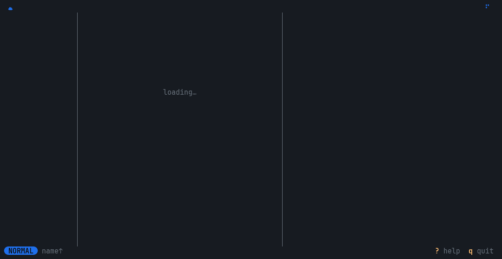
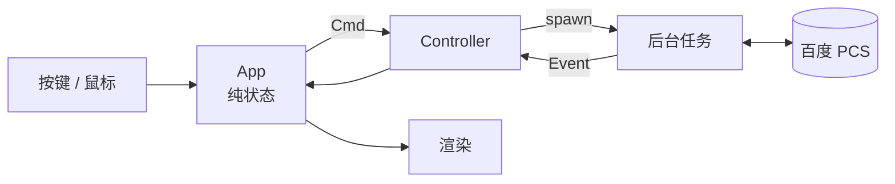

<div align="center">

# ☁ baidupcsr

**百度网盘的终端文件管理器** —— 像 yazi 一样浏览你的网盘

三栏浏览 · 即时预览 · 视频秒播 · 并发续传下载 · Vim 键位

[](https://www.rust-lang.org)
[](https://doc.rust-lang.org/edition-guide/rust-2024/)
[](https://ratatui.rs)
[](#安装)
[](Cargo.toml)



</div>

---

直接复用 [BaiduPCS-Go](https://github.com/qjfoidnh/BaiduPCS-Go) 的登录：在那边登录一次，这边运行 `baidupcsr-cli` 就能看到你的网盘，**不需要再输入任何账号密码**。

## ✨ 特性

<table>
<tr>
<td width="50%" valign="top">

### 🗂 三栏浏览

父目录 │ 当前目录 │ 预览，`h j k l` 走遍整个网盘。目录有内存和磁盘两级缓存，再次打开瞬间显示。窄终端自动变为两栏或单栏。

</td>
<td width="50%" valign="top">

### 👀 即时预览

文本、代码只拉取开头 64 KiB；图片使用百度服务端缩略图，在 kitty / WezTerm / iTerm2 / sixel 终端里显示原图清晰度。光标移走时请求立即取消。

</td>
</tr>
<tr>
<td valign="top">

### ▶️ 视频秒播

回车即把直链交给 **mpv**，几 GB 的 4K 视频数秒起播，进度条随意拖动，不需要先下载，也不需要本地代理。

</td>
<td valign="top">

### ⚡ 并发续传下载

单文件 8 × 4 MiB 分片同时在途（可配置），实测约 65 MiB/s；中断后再下载从 `.part` 断点继续，完成时原子改名。

</td>
</tr>
<tr>
<td valign="top">

### ✂️ 文件整理

`y` 复制、`x` 剪切、`p` 粘贴、`r` 重命名、`a` 新建、`dd` 删除（必须确认），还有 `:` 命令行。

</td>
<td valign="top">

### 🔍 过滤与搜索

`/` 本地实时过滤，`s` 递归搜索并边搜边显示，`:search --api` 调用百度服务端搜索。

</td>
</tr>
</table>

## 🎬 演示

<details open>
<summary><b>批量下载</b> —— 标记多个文件，<code>D</code> 并发下载，<code>T</code> 查看任务并取消</summary>
<br>

</details>

<details open>
<summary><b>过滤与搜索</b> —— <code>/</code> 实时过滤，<code>s</code> 递归搜索，<code>:search --api</code> 服务端搜索</summary>
<br>

</details>

<details open>
<summary><b>文件管理</b> —— 新建目录、复制粘贴、重命名、删除确认</summary>
<br>

</details>

> [!NOTE]
> 动图在模拟网盘中录制（[`docs/demo/`](docs/demo)），没有使用真实账号。GIF 只能用半块字符画图片；在支持图形协议的终端里，预览是原图清晰度。

## 📦 安装

需要 Rust 1.95 或更新版本：

```bash
cargo install --git https://github.com/pengstem/baidupcsr
```

或者从源码构建：

```bash
git clone https://github.com/pengstem/baidupcsr && cd baidupcsr
cargo build --release   # 产物：target/release/baidupcsr-cli
```

可选依赖：

| 依赖 | 用途 |
| --- | --- |
| [BaiduPCS-Go](https://github.com/qjfoidnh/BaiduPCS-Go) | 登录一次（必需） |
| [mpv](https://mpv.io) | 播放视频 |
| [Nerd Font](https://www.nerdfonts.com) | 显示文件图标（没有时设 `icons = "ascii"`） |
| kitty / WezTerm / iTerm2 / foot 等 | 高清图片预览 |

## 🚀 快速开始

```bash
BaiduPCS-Go login        # 第一次使用：在 BaiduPCS-Go 中登录
baidupcsr-cli doctor     # 检查配置与登录（不会打印任何凭据）
baidupcsr-cli            # 打开网盘
```

`doctor` 的输出大致如下：

```text
✓ cache          /home/me/.cache/baidupcsr
✓ ui config      /home/me/.config/baidupcsr/ui_config.toml (not created, using defaults)
✓ player         mpv
✓ downloads      4.00 MiB chunks × 8 in flight
✓ pcs config     /home/me/.config/BaiduPCS-Go/pcs_config.json (owner-only, mode 600)
✓ account        me (uid 123456)
✓ BDUSS          present
✓ STOKEN         present
✓ workdir        /
```

Shell 补全：

```bash
baidupcsr-cli completions zsh > ~/.zfunc/_baidupcsr-cli
```

## ⌨️ 键位

在程序里按 `?` 可以随时查看。

| 导航 | | 选择 | |
| --- | --- | --- | --- |
| `j` `k` `↑` `↓` | 上下移动 | `Space` | 标记并下移 |
| `h` `←` `⌫` | 上级目录 | `v` | 区间选择 |
| `l` `→` `⏎` | 进入 / 播放 / 打开 | `V` | 全选 / 全不选 |
| `gg` `G` | 顶部 / 底部 | `Esc` | 清除标记与过滤 |
| `Ctrl-d` `Ctrl-u` | 半页翻动 | | |
| `Tab` | 焦点切到预览 | | |

| 文件 | | 查找与视图 | |
| --- | --- | --- | --- |
| `D` | 下载 | `/` | 过滤当前目录 |
| `y` `x` | 复制 / 剪切 | `s` | 在当前目录下递归搜索 |
| `p` | 粘贴到当前目录 | `:` | 命令行 |
| `dd` | 删除（需确认） | `S` | 排序（名称 / 时间 / 大小 / 类型） |
| `r` | 重命名 | `R` `Ctrl-r` | 刷新 |
| `a` | 新建目录 | `T` `c` | 任务面板 / 取消任务 |
| | | `q` | 退出 |

**鼠标**：滚轮滚动，单击选中，双击或右键打开；点击面包屑跳转；点击父目录栏定位、点击预览栏中的子目录直接进入。

**命令行** `:`

```text
:mkdir <路径>                 新建目录
:rename <新名字>              重命名光标所在条目
:rename <原路径> <新路径>
:cp [路径…] <目录>            复制（不给路径时用已标记的条目）
:mv [路径…] <目录>            移动
:rm [路径…]                   删除（需确认）
:search [--current|--api] <关键词>
```

## ⚙️ 配置

登录信息来自 BaiduPCS-Go 的 `pcs_config.json`（只读；退出时会把当前目录写回 `workdir`，与 BaiduPCS-Go 的 `cd` 一致）。

baidupcsr 自己的配置在 `~/.config/baidupcsr/ui_config.toml`，**所有字段都是可选的**：

```toml
[ui]
icons = "nerd"              # 没有 Nerd Font 时改为 "ascii"

[download]
dir = "/data/downloads"     # 默认：BaiduPCS-Go 的 savedir，其次是系统下载目录
chunk_size = 4194304        # 分片大小，≥ 64 KiB
concurrency = 8             # 同时在途的分片数，1–32

[network]
proxy = "socks5://127.0.0.1:1080"

[player]
command = "mpv"
args = ["--fs"]
```

| 环境变量 | 作用 |
| --- | --- |
| `BAIDUPCS_GO_CONFIG_DIR` | BaiduPCS-Go 配置所在目录 |
| `BAIDUPCSR_UI_CONFIG` | `ui_config.toml` 的路径 |
| `BAIDUPCSR_CACHE_DIR` | 目录缓存位置 |
| `BAIDUPCSR_DOWNLOAD_DIR` | 下载目录 |
| `BAIDUPCSR_PROXY` | 代理 |
| `NO_COLOR` | 关闭颜色 |

## 🏗 架构一览



界面状态是纯数据、按键处理是纯函数，所有网络和磁盘 I/O 都在可取消的后台任务里，所以界面永远不会卡住，空闲时 CPU 占用为 0。详见[设计说明书](docs/design.md)。

## 📚 文档

| 文档 | 内容 |
| --- | --- |
| [需求报告](docs/requirements.md) | 背景、用户、功能与非功能需求、用例 |
| [项目管理](docs/project-management.md) | 开发模型、WBS、时间线与里程碑、风险与变更 |
| [设计说明书](docs/design.md) | 架构、模块、关键流程、数据与接口、设计决策 |

## 🛠 开发

```bash
cargo test                       # 单元测试 + 界面快照测试
cargo clippy --all-targets       # 禁止 unwrap / expect / panic / unsafe
cargo insta review               # 审查界面快照的变化
```

重新录制演示动图（需要 `ffmpeg`、ImageMagick 和 [agg](https://github.com/asciinema/agg)）：

```bash
cargo build --release
docs/demo/make_assets.sh
python3 docs/demo/record.py      # 输出到 docs/images/*.gif
```

## 🙏 致谢

- [BaiduPCS-Go](https://github.com/qjfoidnh/BaiduPCS-Go) —— 登录、配置格式与接口调用的参考
- [yazi](https://github.com/sxyazi/yazi) —— 交互方式与图标表的灵感来源
- [ratatui](https://ratatui.rs) · [ratatui-image](https://github.com/benjajaja/ratatui-image) · [tokio](https://tokio.rs) · [reqwest](https://github.com/seanmonstar/reqwest)

## ⚠️ 免责声明

本项目与百度公司无关，仅供学习交流。请遵守百度网盘用户协议，勿用于任何违法用途。
