# baidupcsr 设计说明书

| 项目 | 内容 |
| --- | --- |
| 项目名称 | baidupcsr —— 百度网盘终端文件管理器 |
| 文档版本 | v1.0 |
| 对应代码版本 | `baidupcsr-cli` 0.1.0（提交 `b328096`） |
| 编写日期 | 2026-10-12 |
| 相关文档 | [需求报告](requirements.md) · [项目管理](project-management.md) |

---

## 1 引言

### 1.1 目的

本文档说明 baidupcsr 的总体架构、模块划分、关键流程、数据结构、接口与界面设计，以及背后的设计决策。读者为开发者和评审者；文中 `FR-xx`/`NFR-xx` 指向[需求报告](requirements.md)中的需求编号。

### 1.2 设计目标

1. **界面永不阻塞**（NFR-01）：所有 I/O 都在后台，界面线程只做状态更新和绘制；
2. **一切可取消**（NFR-10）：光标移走、任务取消、程序退出时，相关网络请求立刻停止；
3. **状态与副作用分离**（NFR-40）：界面状态是纯数据，按键处理是纯函数，便于测试；
4. **少即是多**：单一可执行文件、单一 crate、尽量少的抽象层；能交给成熟库的不手写（NFR-42）。

### 1.3 技术选型

| 关注点 | 选择 | 理由 |
| --- | --- | --- |
| 语言 | Rust 2024 | 单文件发布、无运行时、内存安全，`unsafe` 被 lint 禁止 |
| 终端界面 | ratatui 0.30 + crossterm 0.29 | Rust 生态最成熟的 TUI 库；crossterm 跨平台，支持异步事件流 |
| 异步运行时 | tokio | 生态标准；`select!`、`JoinSet`、`CancellationToken` 满足取消需求 |
| HTTP | reqwest 0.13（rustls） | 支持代理、multipart、流式读取；rustls 免去 OpenSSL 依赖 |
| 终端图片 | ratatui-image 11 | 自动探测 kitty / sixel / iTerm2，降级为半块字符 |
| 图片解码 | image（gif/jpeg/png/webp） | 只启用需要的格式，带内存上限 |
| 配置 | serde_json（读 BaiduPCS-Go）、toml（自有配置） | 结构化反序列化，缺省值与未知字段可控 |
| 命令行 | clap 4 + clap_complete | 子命令、帮助、补全一次解决 |
| 原子写文件 | atomic-write-file | 配置与缓存写入不会留下半截文件 |
| 缓存 | lru | 按权重淘汰的预览缓存 |
| 测试 | insta（快照）、tempfile | 界面快照可审查 |

---

## 2 总体设计

### 2.1 分层架构

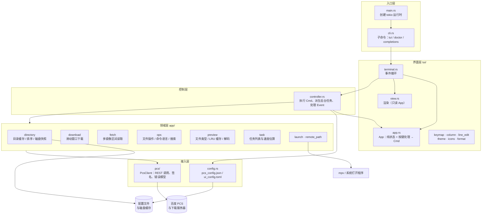

依赖方向自上而下：`tui/app.rs` 只依赖领域层的**纯数据**部分（目录缓存、任务列表、操作定义），不依赖网络；网络、磁盘、子进程这些副作用全部由 `controller.rs` 发起。

### 2.2 运行时模型：单向数据流

借鉴 Elm 架构，把"决定做什么"和"去做"分开：

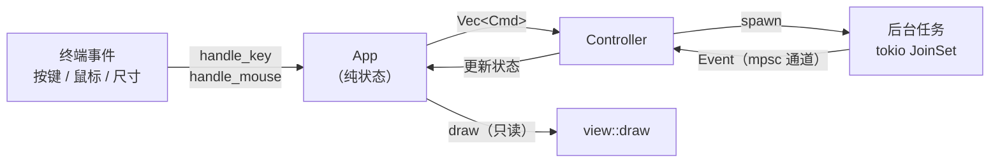

- **`Cmd`**（界面 → 控制器）：`Navigate`、`SelectionChanged`、`Refresh`、`Open(entry)`、`Download(entries)`、`Run(Operation)`、`Search{keyword, mode}`、`Cancel(TaskId)`；
- **`Event`**（后台 → 控制器）：`Listed`、`PreviewBytes`、`Thumbnail`、`ImageEncoded`、`Quota`、`Progress`、`Finished`、`SearchBatch`、`Play`、`Notice`。

事件循环（`tui/terminal.rs`）在一个 `tokio::select!` 中等待三种输入：

```rust
dirty = tokio::select! {
    event = input.next()    => { /* 按键/鼠标 → app.handle_* → controller.run(cmds) */ true }
    Some(e) = events.recv() => { /* 批量取出所有 Event → controller.handle */ true }
    _ = tick.tick(), if animating => app.tick(now),  // 仅在动画时每 100 ms 一帧
};
```

只有 `dirty` 为真才重绘；没有加载动画、跑马灯、提示消息时不启用定时器，**空闲 CPU 为 0**（NFR-02）。

### 2.3 启动与退出

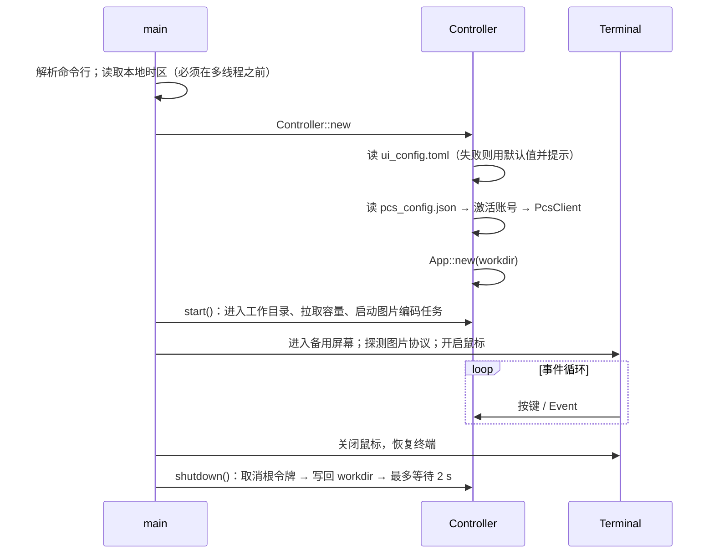

配置或登录有问题时程序仍然启动，以提示消息说明原因（如"log in with BaiduPCS-Go first"），而不是直接退出。

---

## 3 模块设计

### 3.1 模块一览

| 模块 | 行数 | 职责 | 对应需求 |
| --- | ---: | --- | --- |
| `cli.rs` | 150 | 子命令分发；`doctor` 自检 | FR-06, FR-08 |
| `config.rs` | 413 | 两种配置的加载、校验、路径解析；写回 `workdir` | FR-01–05, FR-07 |
| `pcs/client.rs` | 393 | 所有 HTTP 调用、鉴权头、取消、错误转换 | §6.3 |
| `pcs/model.rs` | 301 | `FileEntry`、`ByteRange`、`PcsError`、`locatedownload` 签名 | — |
| `controller.rs` | 820 | 执行 `Cmd`、管理后台任务与取消令牌、处理 `Event` | FR-80 |
| `app/directory.rs` | 349 | 内存目录缓存、代次、排序、磁盘快照 | FR-15, FR-18, NFR-11 |
| `app/download.rs` | 332 | 滑动窗口下载、续传、重试 | FR-51–54 |
| `app/fetch.rs` | 98 | 多镜像轮换、直链刷新、镜像提升 | FR-53 |
| `app/ops.rs` | 351 | 文件操作定义、`:` 命令解析、递归搜索 | FR-60–72 |
| `app/preview.rs` | 206 | 文件类型识别、LRU 预览缓存、图片解码 | FR-30–33 |
| `app/task.rs` | 220 | 任务状态机、速度平滑、历史上限 | FR-80–83 |
| `app/launch.rs` | 77 | 启动 mpv / 系统打开程序 | FR-40–42 |
| `app/remote_path.rs` | 134 | 网盘路径的规范化、拼接、父目录 | — |
| `tui/app.rs` | 1255 | 界面状态、按键与鼠标处理 | FR-10–20, FR-60–63 |
| `tui/view.rs` | 1148 | 布局与绘制 | FR-10, FR-12, FR-81 |
| `tui/column.rs` | 210 | 光标、滚动、过滤后的索引 | FR-70, NFR-05 |
| `tui/keymap.rs` | 129 | 按键 → 动作映射、帮助表 | FR-11, FR-20 |
| `tui/line_edit.rs` | 137 | 单行编辑器（光标、`Ctrl-u/w` 等） | — |
| `tui/theme.rs`, `icons.rs`, `icon_table.rs` | ~1000 | 16 色主题、Nerd Font / ASCII 图标 | NFR-31, NFR-32 |

### 3.2 接入层：`PcsClient`

`PcsClient` 是一个可廉价克隆的结构（内部 `reqwest::Client` 本身是引用计数的），持有设置和 Cookie 串，**凭据不离开这个结构**（NFR-20）。

```rust
pub struct PcsSettings {
    pub app_id: i64,
    pub pcs_addr: String,   // 默认 pcs.baidu.com
    pub https: bool,
    pub pcs_ua: String,     // 调 PCS 接口用的 UA
    pub pan_ua: String,     // 下载服务器要求的网盘客户端 UA
    pub proxy: Option<String>,
}
```

公开方法与百度接口一一对应：`list`、`search`、`quota`、`locate_download_urls`、`fetch_range`、`thumbnail`、`mkdir`、`delete`、`copy`、`rename_or_move`。每个方法都接收 `&CancellationToken`，内部通过

```rust
tokio::select! {
    biased;
    () = cancel.cancelled() => Err(PcsError::Cancelled { operation }),
    result = future => result.map_err(|e| PcsError::network(operation, &e)),
}
```

保证取消优先。连接超时 10 s、读超时 30 s（而不是总超时，避免大文件读取被误杀）。

**直链获取**：`locatedownload` 需要签名参数 `time`、`rand`、`devuid`，由 `locate_sign(time, uid, bduss)` 按 BaiduPCS-Go 的算法用 SHA-1 / MD5 计算。返回的镜像中过滤掉 `encrypt != 0` 和主机名含 `-ant.` 的 P2P 镜像（NFR-23）。

**区间读取**：`fetch_range` 严格校验（NFR-12）——状态码必须是 206、`Content-Range` 必须与请求区间完全一致、实际长度必须等于区间长度，任何一项不符都视为失败。

### 3.3 领域层

#### 目录缓存 `directory.rs`

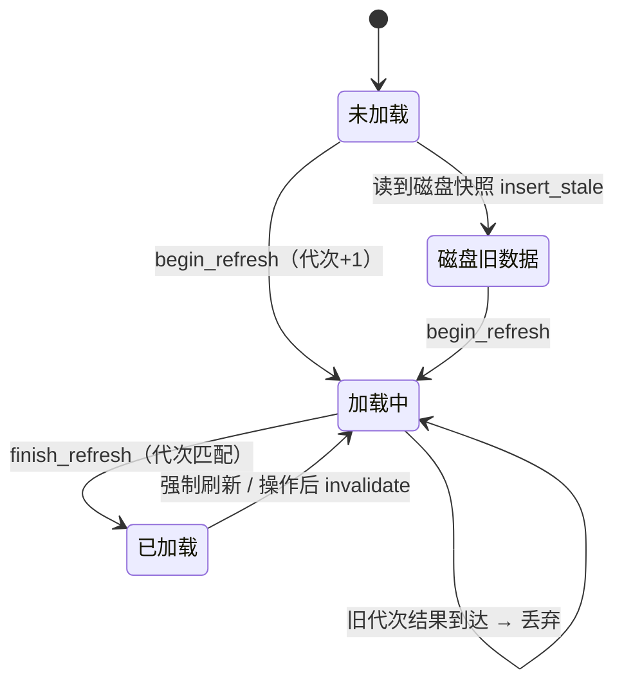

- **代次（Generation）**：每次发起刷新代次 +1，结果带着发起时的代次回来；不是最新代次的结果直接丢弃，解决"先发后到"问题（NFR-11）；
- **排序**：目录永远在前；名称和类型默认升序，修改时间和大小默认降序（最新/最大在前更有用），重复选择同一键反转；排序结果缓存，切换排序时重排所有已缓存目录；
- **磁盘快照** `DirectoryStore`：每个目录一份 JSON，文件名 `dir-<uid>-<fnv1a(path)>.json`。使用 FNV-1a 而不是标准库 `DefaultHasher`，因为后者跨版本不稳定。快照内记录 `account_uid` 与 `path`，读取时再次核对，防止哈希碰撞或换账号时串数据。

#### 区间读取 `fetch.rs`

`RangeFetcher` trait 抽象"读取一个字节区间"，让下载算法可以用伪造实现测试。真实实现 `RemoteFile`：

```text
for refresh in [false, true]:          # 第二轮先重新 locatedownload
    for url in 镜像列表:
        成功 → 把该镜像提升到列表首位，返回
        被取消 → 立即返回
        失败 → 记录错误，试下一个
返回最后一个错误
```

"提升"让后续区间优先使用刚刚成功的镜像。`working_url()` 用 1 字节区间探测出可用镜像交给播放器。

#### 下载 `download.rs`

见 §4.3。

#### 文件操作 `ops.rs`

```rust
pub enum Operation {
    Mkdir(String),
    Delete(Vec<String>),
    Rename { from: String, to: String },
    Copy(Vec<FileOperationPair>),
    Move(Vec<FileOperationPair>),
}
```

每个操作能给出：`summary()`（任务列表与提示中的一句话）、`details()`（确认框中的完整路径）、`is_destructive()`（是否需要确认）、`affected_dirs()`（完成后需要刷新的目录）。`:` 命令先用 `shell-words` 分词（支持引号），再按 `(命令, 参数)` 模式匹配成 `Operation` 或搜索请求；相对路径基于当前目录解析。`transfer_into` 拒绝把目录粘贴进自身或其子目录。

#### 任务 `task.rs`

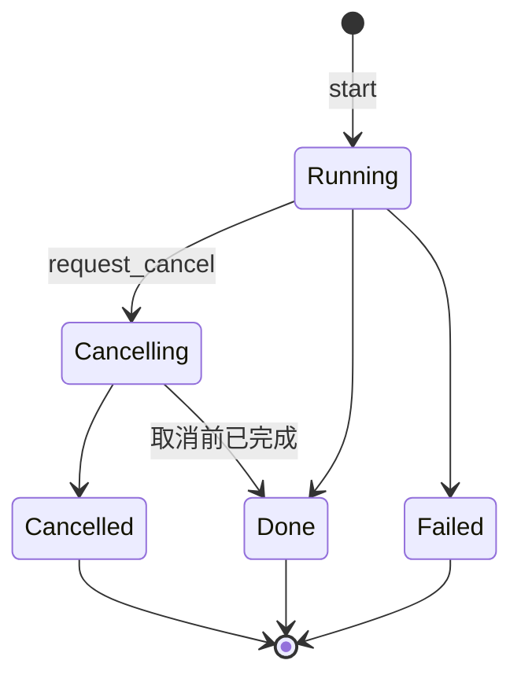

速度用指数平滑：两次采样间隔 ≥0.2 s 才更新，`speed = 0.7·旧 + 0.3·新`；第一次采样只记录基准，所以续传时已存在的字节不会被算成"瞬间速度"。剩余时间 = 剩余字节 / 速度。已结束任务最多保留 64 条（NFR-04）。

#### 预览 `preview.rs`

- `FileKind::from_name` 按扩展名把文件分为目录、视频、音频、图片、文本、代码、字幕、压缩包、文档、PDF、电子书、字体、其它，`README`/`LICENSE`/`SHA256SUMS` 等无扩展名文件视为文本；
- `PreviewCache<V>`：以 `(fs_id, mtime)` 为键的 LRU，按值的字节数计权，文本上限 16 MiB、缩略图上限 32 MiB——文件被修改后 `mtime` 变化，缓存自然失效；
- `decode_image` 设置 `image::Limits`（最大分配 128 MiB），防止恶意或超大图片耗尽内存。

### 3.4 控制层：`Controller`

```rust
pub struct Controller {
    pub app: App,
    session: Option<Session>,          // PcsClient + Account；未登录时为 None
    store: DirectoryStore,             // 磁盘目录快照
    texts: TextCache, thumbnails: ThumbnailCache,
    picker: Option<Picker>,            // 终端图片协议
    events: UnboundedSender<Event>,
    root: CancellationToken,           // 所有后台任务的祖先
    jobs: JoinSet<()>,
    preview_cancel: CancellationToken, // 当前预览请求
    thumbnail_cancel: CancellationToken,
    task_cancels: HashMap<TaskId, CancellationToken>,
    search_task: Option<TaskId>,       // 同时只保留一个搜索
    player: Option<Child>,             // 同时只保留一个播放器
    // …
}
```

两类后台工作：

- **`spawn`**：短小、对用户不可见的工作（列目录、取预览、取缩略图、取容量），结果以 `Event` 回送；
- **`spawn_task`**：进入任务列表、可被用户取消的工作（下载、打开、文件操作、搜索），结束时统一发送 `Event::Finished{id, outcome}`，由 `finish()` 更新任务状态、弹出提示、刷新受影响目录、必要时用系统程序打开文件。

### 3.5 界面层

#### `App` 状态

| 字段 | 含义 |
| --- | --- |
| `cache: DirectoryCache` | 所有已知目录 |
| `cwd`, `column: Column` | 当前目录、光标 / 滚动 / 过滤 |
| `search: Option<SearchView>` | 搜索结果视图（存在时替代当前目录） |
| `marks`, `visual` | 已标记路径集合、区间选择锚点 |
| `clipboard` | 复制或剪切的路径 |
| `preview` | 当前预览的路径、内容、滚动、图片状态 |
| `focus` | 文件列表 / 预览 |
| `overlay` | 无 / 帮助 / 排序 / 任务 / 确认操作 / 确认退出 |
| `input` | 输入模式（过滤 / 搜索 / 命令 / 重命名 / 新建目录）与行编辑器 |
| `tasks`, `toasts`, `quota` | 任务列表、提示消息、容量 |
| `remembered` | 每个目录上次选中的子项（FR-14） |
| `pending` | 两键命令的第一键（`g`、`d`） |
| `regions` | 上一帧各区域的位置，供鼠标命中测试 |

#### 按键处理优先级

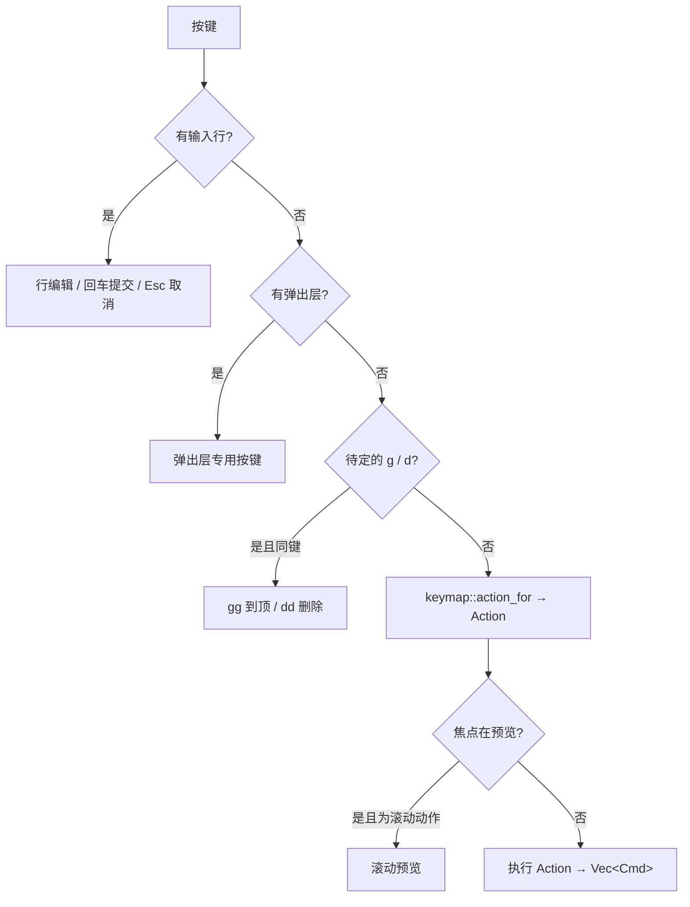

#### `Column`：过滤与大目录

`Column` 不复制条目，只保存"通过过滤的条目下标"`visible: Vec<usize>` 和光标位置。过滤字符串变化时重算下标；目录内容变化时 `rebuild` 尽量把光标留在原来那个文件上，找不到则留在原来的位置附近。渲染时只取屏幕可见范围的下标，上万条目也只绘制几十行（NFR-05）。

---

## 4 关键流程设计

### 4.1 进入目录与预览

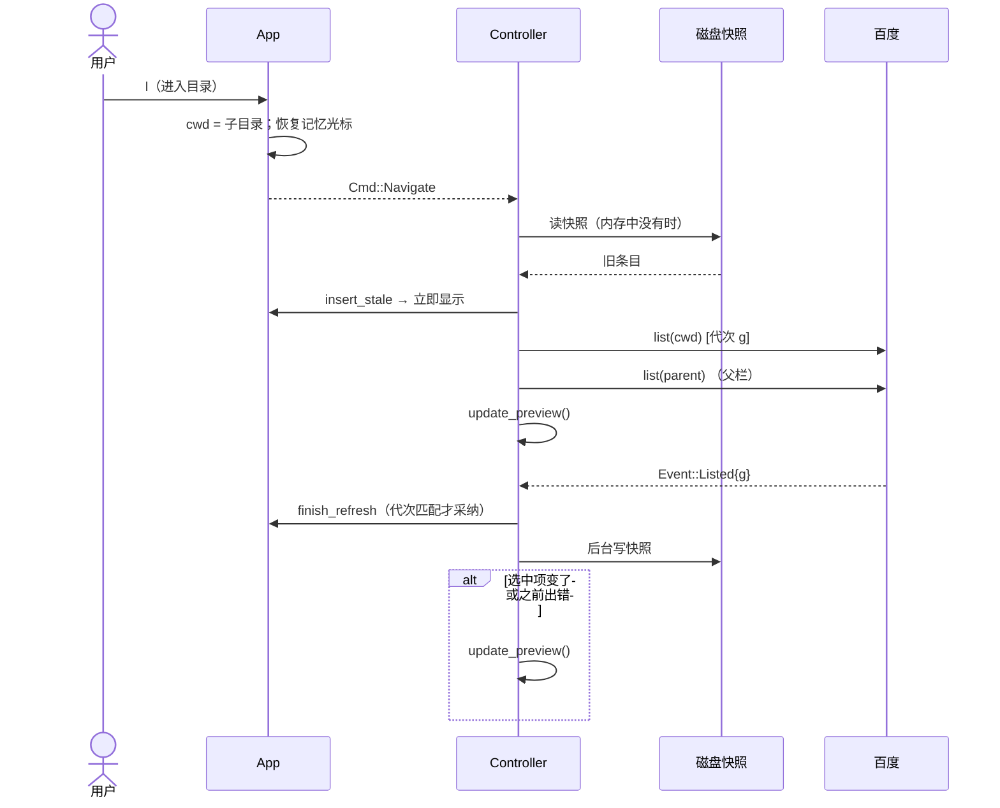

`update_preview` 先取消上一次预览令牌，再根据文件类型决定：

| 类型 | 动作 |
| --- | --- |
| 目录 | 预取子目录列表（右栏显示其内容，FR-17 点击子项直接进入） |
| 视频 | 显示"⏎ 播放 · D 下载" |
| 文本 / 代码 / 字幕 | 命中缓存直接显示；否则取前 64 KiB（FR-31） |
| 图片 | 取前 64 KiB 识别格式与尺寸，**同时**请求服务端缩略图 |
| 其它 | 显示"⏎ 用默认程序打开 · D 下载"或"太大" |

缩略图边长按预览区的**像素**大小计算：`max(列数×字宽, 行数×字高)`，向上取整到 400 的倍数并限制在 400–1600，既清晰又不浪费流量。解码在 `spawn_blocking` 中进行；缩放与终端协议编码在专门的后台任务里进行，并且**只处理最新的请求**（快速翻图时旧请求直接丢弃）。

结果到达时检查 `app.is_selected(entry.path)`，不是当前选中项就丢弃（FR-35）。

### 4.2 播放视频

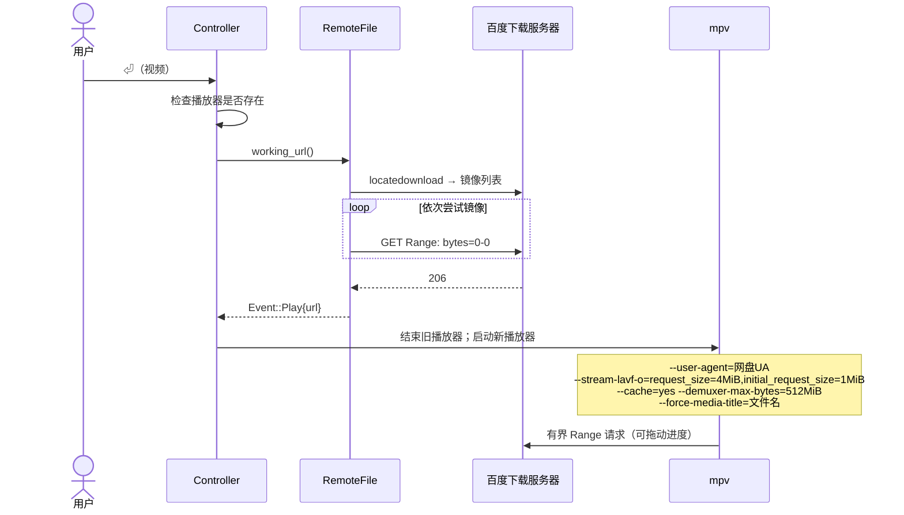

关键在于 `request_size`：它让 ffmpeg 发出 `bytes=N-M` 形式的有界请求，而百度对开放式 `bytes=N-` 返回 403（约束 C3）。播放器在独立进程组中启动、标准输入输出置空，不会干扰终端界面。

### 4.3 下载：滑动窗口 + 顺序落盘

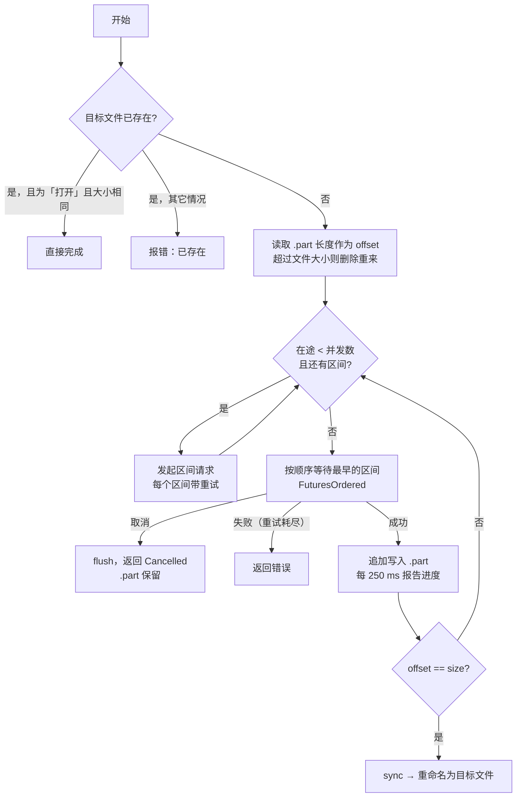

设计要点：

- **`FuturesOrdered`** 让最多 `concurrency` 个区间同时在途，但**按文件顺序**交付结果，所以 `.part` 永远是一段连续前缀——续传只需看文件长度，不需要额外的位图或元数据文件；
- **重试**：每个区间失败后按 0.25 s → 1 s → 4 s 退避重试 3 次，期间可被取消；区间内部的镜像轮换由 `RemoteFile` 负责；
- **背压**：写盘慢时不会继续发起新请求，内存占用上限约为 `并发数 × 分片大小`（默认 32 MiB）；
- **原子完成**：全部写完后 `sync_all` 再 `rename`，目标文件要么不存在，要么是完整的。

### 4.4 文件操作

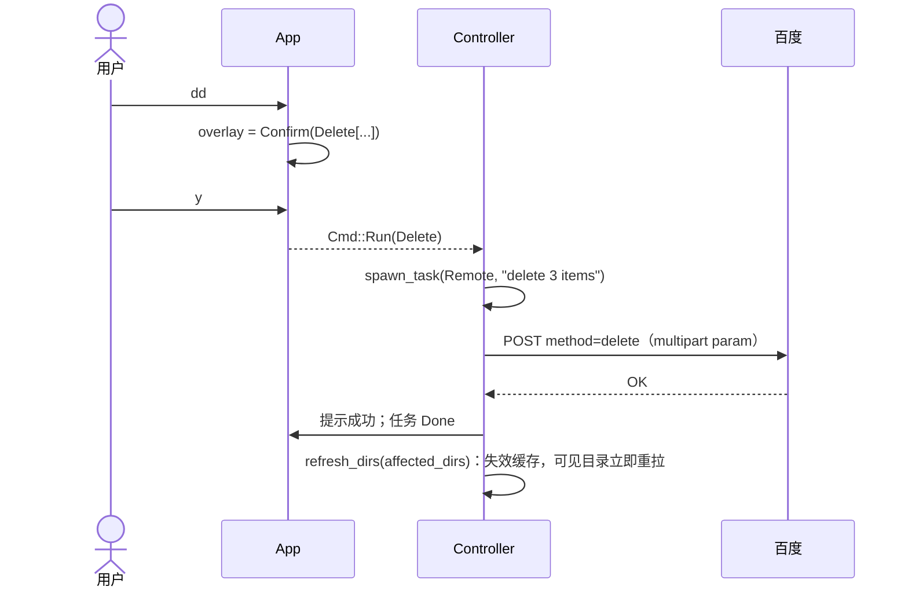

非破坏性操作（新建、重命名、复制、移动）直接执行，不弹确认框。

### 4.5 递归搜索

`ops::search` 用广度优先队列从当前目录逐层 `list`，在本地做不区分大小写的包含匹配；每 64 条或每个目录结束时通过回调发出一批结果（`Event::SearchBatch`），界面边搜边显示；最多 2000 条。开始新搜索时取消旧搜索。`--api` 模式直接调用百度服务端搜索，`--current` 只搜当前目录。

---

## 5 数据设计

### 5.1 核心数据结构

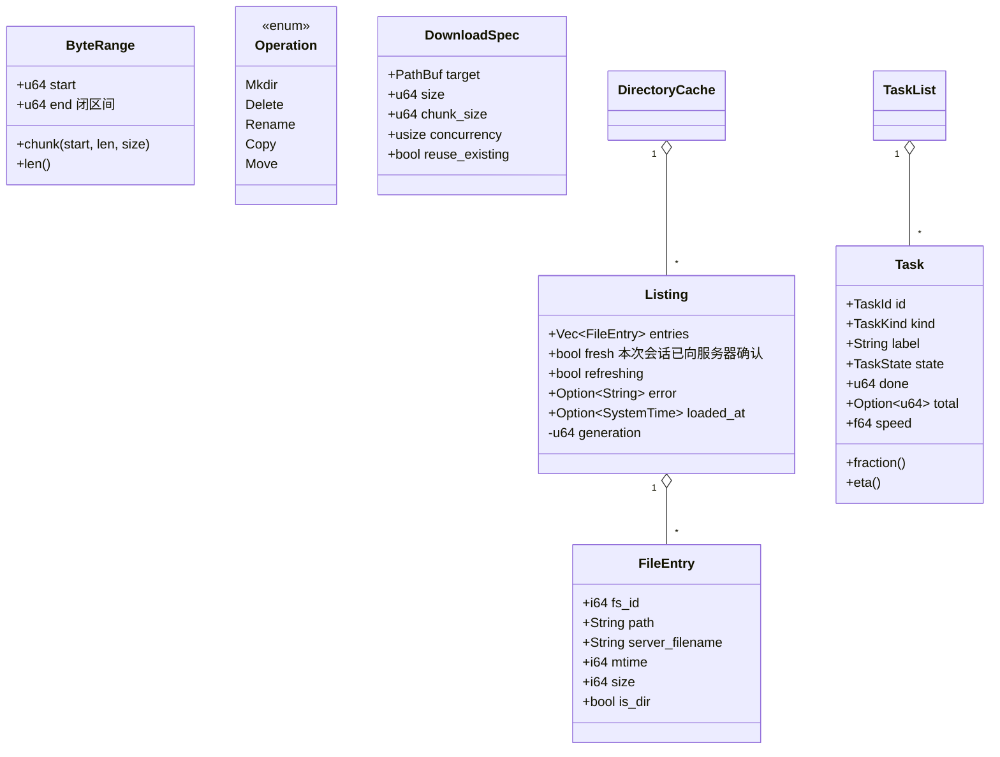

`ByteRange` 只能通过 `new`（检查 `start ≤ end`）或 `chunk`（检查非空、裁剪到文件大小）构造，从类型上保证不会发出开放式或空区间请求。

### 5.2 持久化数据

**BaiduPCS-Go 配置**（只读，用到的字段）：

```jsonc
{
  "baidu_active_uid": 123456,
  "baidu_user_list": [
    { "uid": 123456, "name": "…", "bduss": "…", "stoken": "…",
      "baiduid": "…", "cookies": "…", "workdir": "/我的资源" }
  ],
  "appid": 266719, "pcs_addr": "pcs.baidu.com", "enable_https": true,
  "user_agent": "…", "pcs_ua": "…", "pan_ua": "…",
  "savedir": "/data/downloads", "proxy": ""
}
```

所有字段 `#[serde(default)]`，缺失即默认值。Cookie 优先使用完整的 `cookies` 串，否则由 `bduss/stoken/baiduid` 拼装（使用 `cookie` 库保证格式正确）。UA 按"专用 UA → `user_agent` → `pan_ua` → `pcs_ua` → `netdisk`"的顺序取第一个非空值。

**写回 workdir**：以 `serde_json::Value` 读入整个文件，只修改激活账号的 `workdir`，其它字段（包括本程序不认识的）原样保留，再原子写回；值没变时不写（NFR-21）。

**界面配置** `ui_config.toml`：

```toml
[ui]
icons = "nerd"            # nerd | ascii

[download]
dir = "/data/downloads"   # 可选
chunk_size = 4194304      # ≥ 65536
concurrency = 8           # 1..=32

[network]
proxy = "socks5://127.0.0.1:1080"

[player]
command = "mpv"
args = ["--fs"]
```

`deny_unknown_fields` 让拼写错误立刻报错而不是被静默忽略。

**目录快照**：`{cache_dir}/dir-{uid}-{fnv1a(path):016x}.json`，内容为 `{account_uid, path, saved_at_unix_seconds, entries}`。

---

## 6 接口设计

### 6.1 命令行

| 命令 | 说明 | 退出码 |
| --- | --- | --- |
| `baidupcsr-cli [tui]` | 打开文件管理器 | 0 正常 / 1 终端错误 |
| `baidupcsr-cli doctor [--config-dir DIR]` | 自检 | 0 全部通过 / 1 有问题 |
| `baidupcsr-cli completions SHELL` | 输出补全脚本 | 0 |

`doctor` 输出示例（不含任何凭据）：

```text
✓ cache          /home/me/.cache/baidupcsr
✓ ui config      /home/me/.config/baidupcsr/ui_config.toml (not created, using defaults)
✓ player         mpv
✓ downloads      4.00 MiB chunks × 8 in flight
✓ pcs config     /home/me/.config/BaiduPCS-Go/pcs_config.json (owner-only, mode 600)
✓ account        me (uid 123456)
✓ BDUSS          present
✓ STOKEN         present
✓ workdir        /我的资源
```

### 6.2 环境变量

| 变量 | 作用 |
| --- | --- |
| `BAIDUPCS_GO_CONFIG_DIR` | BaiduPCS-Go 配置目录 |
| `BAIDUPCSR_UI_CONFIG` | 界面配置文件路径 |
| `BAIDUPCSR_CACHE_DIR` | 缓存目录 |
| `BAIDUPCSR_DOWNLOAD_DIR` | 下载目录（覆盖配置文件） |
| `BAIDUPCSR_PROXY` | 代理（覆盖配置文件） |
| `NO_COLOR` | 关闭颜色，改用粗体/反色/暗淡区分 |

### 6.3 百度接口

| 方法 | 端点 | 关键参数 | UA / 鉴权 |
| --- | --- | --- | --- |
| `list` | `GET /rest/2.0/pcs/file` | `method=list&path&by=name&order=asc` | PCS UA + Cookie |
| `search` | `GET /rest/2.0/pcs/file` | `method=search&path&wd&re=1` | PCS UA + Cookie |
| `locate_download_urls` | `POST /rest/2.0/pcs/file` | `method=locatedownload&app_id=250528&path&time&rand&devuid&ver=4.0…` | 网盘 UA + Cookie |
| `fetch_range` | `GET <直链>` | `Range: bytes=N-M` | 仅网盘 UA |
| `thumbnail` | `GET /rest/2.0/pcs/thumbnail` | `method=generate&path&width&height&quality=90` | PCS UA + Cookie |
| `mkdir` | `POST /rest/2.0/pcs/file` | `method=mkdir&path` | PCS UA + Cookie |
| `delete`/`copy`/`move` | `POST /rest/2.0/pcs/file` | `method=…`，multipart 字段 `param={"list":[…]}` | PCS UA + Cookie |
| `quota` | `GET https://pan.baidu.com/api/quota` | `checkexpire=1&checkfree=1` | 网盘 UA + Cookie |

响应体中出现非零的 `error_code` 或 `errno` 时转为 `PcsError::Remote`，优先使用服务端的 `error_msg`，否则查表给出提示（§8）。

### 6.4 外部程序

| 程序 | 调用方式 |
| --- | --- |
| mpv | `mpv --user-agent=… --stream-lavf-o=request_size=4194304,initial_request_size=1048576 --cache=yes --demuxer-max-bytes=512MiB --force-media-title=… [用户参数] <直链>`；非 mpv 播放器只传用户参数和直链 |
| 打开文件 | Linux 依次尝试 `xdg-open`、`gio open`；macOS `open`；Windows `cmd /C start ""` |

---

## 7 界面设计

### 7.1 布局

```text
 ☁ › 我的资源 › 开源电影                                         ⠋  ☁ 1.2 TiB / 2.0 TiB   ← 标题栏：面包屑 · 加载动画 · 容量
 我的资源/  │ 字幕/                                2 │ ▶ Sintel.2010.4K.UHD.HDR.mkv
 纪录片/    │ Big.Buck.Bunny.2008.2160p.mp4  850 MiB │
            │▌Sintel.2010.4K.UHD.HDR.mkv    4.71 GiB│ Size      4.71 GiB  (5057323991 bytes)
            │ Spring.2019.2160p.WEB-DL.mkv  2.23 GiB │ Modified  2026-08-22 22:13
            │ Tears.of.Steel.2012.2160p.mkv 6.05 GiB │ Kind      video
            │                                        │ ────────────────────────────────
            │                                        │ ⏎  play in mpv      D  download
  父目录 1/7 │            当前目录 3/7                │              预览 3/7
 ▲ archlinux-2026.10.01-x86_64.iso   ━━━━━━━━━━──────────   52%  22.2 MiB/s  0:04       ← 传输栏（最多 3 行）
 NORMAL  3/6  ● 2 marked  name↑                                          ? help  q quit  ← 状态栏
```

| 终端宽度 | 布局 |
| --- | --- |
| ≥ 100 列 | 三栏，宽度比 1 : 3 : 3 |
| 60–99 列 | 两栏（当前目录 : 预览 = 1 : 1） |
| < 60 列 | 单栏 |

快照测试 `three_columns_when_wide`、`two_columns_with_dock_and_marks`、`single_column_when_narrow` 固定了这三种布局。

### 7.2 模式与弹出层

| 模式徽标 | 进入 | 说明 |
| --- | --- | --- |
| `NORMAL` | 默认 | 浏览 |
| `FILTER` | `/` | 输入即过滤 |
| `SEARCH` | `s` | 输入关键词，回车开始搜索；结果视图中也显示此徽标 |
| `COMMAND` | `:` | 命令行 |
| `RENAME` | `r` | 预填原名 |
| `MKDIR` | `a` | 新目录名 |

弹出层：帮助（`?`，四组键位表）、排序（`S`）、任务面板（`T`，`j/k` 选择、`c` 取消）、删除确认、退出确认。提示消息（toast）分信息 / 成功 / 错误三级，在右下角堆叠显示并自动消失。

### 7.3 视觉规范

- **颜色**：只用 ANSI 16 色——青色为强调色（光标条、标题、链接），深灰为次要信息，绿 / 黄 / 红表示成功 / 警告 / 错误。这样界面自动跟随用户终端的配色方案，深浅主题都可读；
- **光标**：圆角色块，选中行黑字青底加粗；非焦点栏的光标为灰色；
- **图标**：参照 yazi 的图标表，按文件名和扩展名映射 Nerd Font 图标与颜色；悬停或当前所在的目录显示"打开的文件夹"图标；
- **宽字符**：所有截断、对齐使用 `unicode-width` 计算显示宽度，长文件名在光标停留 1 秒后以 150 ms/字的速度滚动。

---

## 8 错误处理设计

```rust
pub enum PcsError {
    Cancelled { operation },                 // 用户取消，不提示错误
    Network   { operation, message },        // 连接、超时、HTTP 状态码
    Parse     { operation, message },        // 响应格式不符、区间不匹配
    Remote    { operation, code, message },  // 百度返回的错误码
    InvalidArgument(&'static str),           // 本地参数错误
}
```

- 每个错误都带操作名，提示形如 `download: HTTP 403`、`list: remote error -6: login expired, refresh BDUSS`；
- 网络错误把完整的错误链（`source()`）拼成一行，便于定位代理、DNS、TLS 问题；
- 常见错误码查表：`-6/110/111` 登录过期；`-7/31066` 文件不存在；`-8/31061` 文件已存在；`-9` 无权限；`31045/31326` 访问被拒、稍后再试；
- 取消不是错误：所有路径都先判断 `is_cancelled()`，被取消的结果不显示、不提示；
- 配置错误不阻止启动，以提示消息告知；`ui_config.toml` 有误时回退为默认配置。

---

## 9 设计决策记录

### ADR-1 视频播放：直链交给 mpv，而不是本地代理

- **背景**：初版设计要求播放器只能访问 `127.0.0.1` 上的本地代理，由程序控制 Range 请求、内存区间缓存和预取（迭代 1、3 实现，约 1,300 行，含辅助进程）。
- **问题**：代理增加了一跳延迟和一个需要管理生命周期的进程；拖动进度时的请求形态要适配 mpv 的各种模式；区间缓存与预取的调优复杂。
- **决定**：直接把直链交给 mpv，用 `--stream-lavf-o=request_size=…` 让 ffmpeg 发出有界请求，再加上 mpv 自身 512 MiB 的解复用缓存。
- **结果**：删除代理及辅助进程；起播与拖动体验不差于代理方案；代价是程序不再控制播放流量（可接受）。

### ADR-2 单包架构

- **背景**：初版为 6 个 crate 的 workspace（config / pcs / core / preview / tui / cli）。
- **决定**：合并为一个 crate，以模块划分边界（`pcs/`、`app/`、`tui/`）。
- **理由**：个人项目没有独立发布子 crate 的需求；跨 crate 改接口需要同时改多处 `Cargo.toml` 和可见性；编译单元更少，增量编译更快。

### ADR-3 纯状态 App + Cmd

- **决定**：`App::handle_key/handle_mouse` 只修改内存状态并返回 `Vec<Cmd>`，不做任何 I/O。
- **理由**：界面逻辑（占代码量最大的部分）可以在没有网络、没有终端的情况下用普通单元测试覆盖；副作用集中在 `Controller`，取消和错误处理只需写一处。

### ADR-4 顺序落盘的滑动窗口下载

- **备选**：(a) 多线程各写文件不同偏移 + 位图记录完成区间；(b) 滑动窗口按顺序写入。
- **决定**：(b)。
- **理由**：(a) 需要预分配文件和额外的元数据文件，崩溃恢复复杂；(b) 的 `.part` 永远是连续前缀，续传逻辑只有一行（读文件长度），实测吞吐已接近带宽上限。

### ADR-5 图片预览使用服务端缩略图

- **背景**：早期取文件前 64 KiB 解码，大图（几 MB 的照片）只拿到开头无法解码。
- **决定**：调用 `thumbnail` 接口按预览区像素大小获取 JPEG，结果按 `(fs_id, mtime)` 缓存。
- **结果**：任意大小的图片都能秒开，流量通常只有几十 KB。

### ADR-6 只用 16 色

- **决定**：不使用 RGB 真彩色，只使用终端调色板。
- **理由**：真彩色主题在用户的浅色终端或自定义配色下可能难以阅读；16 色让程序天然融入用户的主题，并且 `NO_COLOR` 时有一致的降级方案。

### ADR-7 不请求 P2P 加速镜像

- **背景**：`locatedownload` 带 `ant=1` 时会返回 `*-ant.baidu.com` 镜像，实测这些节点重定向后返回被打乱的字节。
- **决定**：不带 `ant=1`，并在结果中过滤主机名含 `-ant.` 的地址；同时对每个区间做严格的 206 / `Content-Range` / 长度校验，任何异常都不会写入文件。

---

## 10 安全设计

| 威胁 | 措施 |
| --- | --- |
| 凭据泄露 | Cookie 只保存在 `PcsClient` 内部，不提供读取接口，也不写日志；`doctor` 只报"present / missing" |
| 配置被破坏 | 只写 `workdir` 一个字段，保留其余内容，原子写入 |
| 误删 | 删除必须经过模态确认框，列出全部路径 |
| 恶意 / 超大响应 | 缩略图 ≤8 MiB（流式读取中途超限即中止）、图片解码 ≤128 MiB、预览只取 64 KiB |
| 数据损坏 | 区间响应三重校验；`.part` 超过文件大小时丢弃重来；完成时原子重命名 |
| 内存安全 | `unsafe_code = "forbid"`；`unwrap/expect/panic` 被 clippy 拒绝；release 下 `panic = "abort"` |
| 子进程影响终端 | 播放器和打开程序的标准输入输出全部置空；播放器在独立进程组中 |
| 配置文件权限 | `doctor` 检查 `pcs_config.json` 是否对其他用户可读并提示 |

---

## 11 性能设计

| 场景 | 措施 |
| --- | --- |
| 空闲 | 只在状态变化后重绘；无动画时不开定时器 |
| 事件突发 | 一次唤醒后用 `try_recv` 取空通道再重绘一次（例如下载进度批量到达） |
| 大目录 | `Column` 只保存下标；过滤结果缓存；只绘制可见行 |
| 重复访问 | 目录：内存 + 磁盘双层缓存，先显示旧数据再后台刷新；预览：LRU |
| 快速移动光标 | 取消上一个预览/缩略图请求；图片编码只处理最新请求 |
| 下载 | 滑动窗口并发；`Bytes` 零拷贝传递；每 250 ms 报告一次进度 |
| 启动 | 磁盘快照让上次访问过的目录瞬间显示；dev 构建中依赖以 `opt-level=2` 编译，调试时也流畅 |
| 发布构建 | LTO、单代码生成单元、strip |

---

## 12 测试设计

| 被测对象 | 测试要点 | 位置 |
| --- | --- | --- |
| 配置 | 部分字段可加载、Cookie 拼装、TOML 校验与未知字段报错、写回 `workdir` 保留未知字段 | `config.rs` |
| PCS 模型 | 区间裁剪、列表解析与 `isdir` 转换、错误码映射、签名稳定性、P2P 镜像识别 | `pcs/` |
| 目录缓存 | 目录优先的双向排序、过期结果被忽略、快照按账号往返 | `app/directory.rs` |
| 下载 | 窗口内按序落盘、临时失败重试、重试耗尽放弃、从 `.part` 续传、完整 `.part` 直接改名、已存在目标的处理、取消后保留连续前缀（伪造 `RangeFetcher`） | `app/download.rs` |
| 命令解析 | 相对路径解析、错误提示、搜索模式、拒绝原地粘贴与粘贴进自身 | `app/ops.rs` |
| 任务 | 生命周期、历史上限、续传字节不计入速度 | `app/task.rs` |
| 界面状态 | 导航往返、`gg`/`dd` 两键、标记与区间、过滤实时生效、粘贴生成操作、命令错误提示、搜索进出、鼠标点击父栏/子栏 | `tui/app.rs` |
| 界面渲染 | 三种布局、帮助面板适配、确认框（insta 快照） | `tui/view.rs` |

运行：`cargo test`（57 个测试，约 0.02 s）。界面改动后用 `cargo insta review` 审查快照差异。离线演示与手动调试可使用 `docs/demo/fake_pcs.py` 提供的模拟网盘。

---

## 13 需求追踪

| 需求 | 设计章节 | 主要实现 |
| --- | --- | --- |
| FR-01–05 配置 | §5.2 | `config.rs` |
| FR-06 doctor | §6.1 | `cli.rs` |
| FR-10–20 浏览 | §3.5, §4.1, §7 | `tui/app.rs`, `tui/view.rs`, `app/directory.rs` |
| FR-30–35 预览 | §4.1 | `controller.rs::update_preview`, `app/preview.rs` |
| FR-40–42 播放与打开 | §4.2, §6.4 | `app/launch.rs`, `app/fetch.rs` |
| FR-50–55 下载 | §4.3 | `app/download.rs` |
| FR-60–65 文件管理 | §3.3, §4.4 | `app/ops.rs` |
| FR-70–73 查找 | §3.5, §4.5 | `tui/column.rs`, `app/ops.rs::search` |
| FR-80–84 任务 | §3.3, §3.4 | `app/task.rs`, `controller.rs::spawn_task` |
| NFR-01/02 | §2.2, §11 | `tui/terminal.rs` |
| NFR-10/11 | §3.3, §3.4 | `CancellationToken`, `Generation` |
| NFR-12 | §3.2 | `PcsClient::fetch_range` |
| NFR-20–25 | §10 | — |
