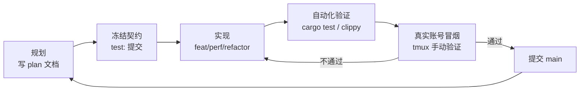
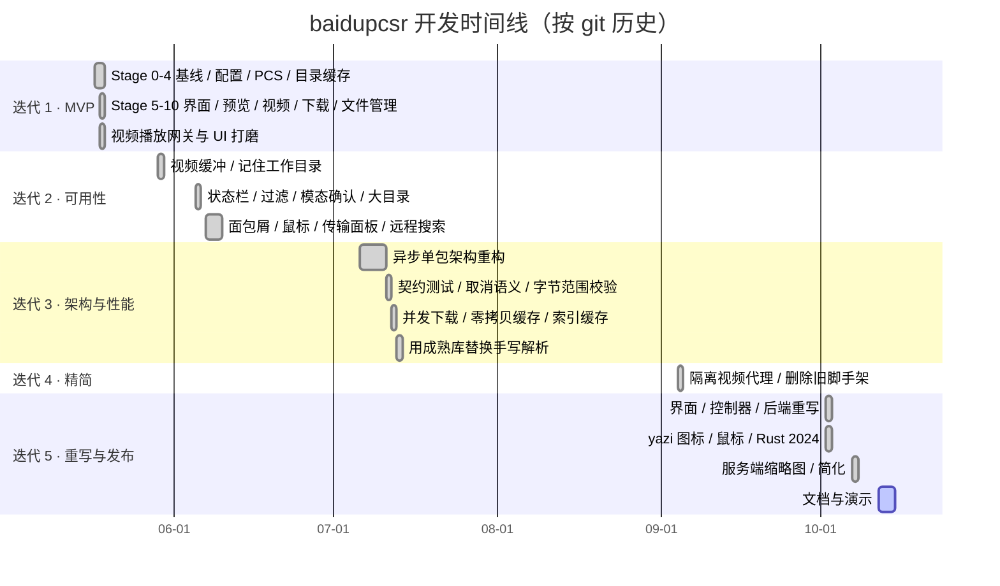

# baidupcsr 项目管理文档

| 项目 | 内容 |
| --- | --- |
| 项目名称 | baidupcsr —— 百度网盘终端文件管理器 |
| 文档版本 | v1.0 |
| 项目周期 | 2026-05-17 至今（首个可用版本 2026-10-07） |
| 编写日期 | 2026-10-12 |
| 相关文档 | [需求报告](requirements.md) · [设计说明书](design.md) |

> 本文中的时间、提交数、代码量均取自仓库 git 历史，可用文末附录中的命令复现。

---

## 1 项目概况

### 1.1 目标

在终端里提供 yazi 式的百度网盘文件管理体验：复用 BaiduPCS-Go 的登录，支持浏览、预览、视频直播、并发续传下载和文件整理（详见[需求报告](requirements.md)）。

### 1.2 范围

| 范围内 | 范围外 |
| --- | --- |
| 读取 BaiduPCS-Go 登录信息 | 登录 / 扫码 / 验证码 |
| 浏览、排序、过滤、搜索 | 上传 |
| 文本、图片预览；视频交给 mpv 播放 | 分享链接、转存、离线下载 |
| 下载（并发、续传、取消） | 回收站、文件历史版本 |
| 新建目录、重命名、复制、移动、删除 | 多账号切换界面（沿用 BaiduPCS-Go 的激活账号） |

### 1.3 项目规模（截至 `b328096`）

| 指标 | 数值 |
| --- | --- |
| 提交数 | 103 次，分布在 15 个开发日 |
| 生产代码 | 约 8,000 行 Rust（`src/`，含单元测试） |
| 自动化测试 | 57 个（其中 5 个为界面快照测试），全部通过 |
| 累计改动 | +59,488 / −47,375 行（经历两次大规模重构） |
| 第三方依赖 | 28 个直接依赖（ratatui、tokio、reqwest 等） |

### 1.4 组织与角色

本项目为个人项目，一人承担全部角色，但按职责区分工作方式：

| 角色 | 职责 | 产出 |
| --- | --- | --- |
| 产品 | 定义场景与需求、确定优先级 | 需求报告、阶段计划 |
| 架构 | 模块划分、技术选型、设计决策 | 设计说明书、决策记录 |
| 开发 | 编码、单元测试 | 源码、测试 |
| 测试 | 契约测试、快照测试、真实账号冒烟 | 测试用例、验证记录 |
| 发布 | 依赖升级、版本与文档 | Cargo 配置、README |

AI 编程助手（Claude Code / Codex）作为辅助工具参与编码与评审，所有改动由本人审阅后提交。

---

## 2 开发模型

采用**阶段门控的迭代增量模型**：

1. **阶段门控（Stage-gate）**：第一轮开发拆成 Stage 0–10，每个阶段有明确目标、任务和验收条件，前一阶段验收通过才进入下一阶段；
2. **契约先行**：重构和性能优化阶段，先提交一个 `test:` 提交"冻结"现有行为（契约测试），再提交实现，保证改动不破坏既有行为；
3. **迭代打磨**：每一轮迭代聚焦一个主题（可用性、架构、性能、安全、重写），以可运行版本结束。



---

## 3 工作分解结构（WBS）

```mermaid
flowchart TD
    P[baidupcsr] --> W1[1 基线与规划]
    P --> W2[2 基础设施]
    P --> W3[3 网盘接入]
    P --> W4[4 终端界面]
    P --> W5[5 预览与播放]
    P --> W6[6 下载与任务]
    P --> W7[7 文件管理与查找]
    P --> W8[8 质量保障]
    P --> W9[9 发布与文档]

    W1 --> W1a[1.1 参考实现分析] & W1b[1.2 兼容契约与夹具] & W1c[1.3 阶段计划]
    W2 --> W2a[2.1 工程脚手架] & W2b[2.2 配置兼容] & W2c[2.3 命令行与 doctor]
    W3 --> W3a[3.1 PCS 客户端] & W3b[3.2 签名与直链] & W3c[3.3 错误模型]
    W4 --> W4a[4.1 状态核心] & W4b[4.2 三栏视图] & W4c[4.3 键位与鼠标] & W4d[4.4 主题与图标]
    W5 --> W5a[5.1 文本预览] & W5b[5.2 图片缩略图] & W5c[5.3 视频播放]
    W6 --> W6a[6.1 分片并发下载] & W6b[6.2 断点续传] & W6c[6.3 任务面板]
    W7 --> W7a[7.1 增删改移] & W7b[7.2 命令行模式] & W7c[7.3 过滤与搜索]
    W8 --> W8a[8.1 单元/契约测试] & W8b[8.2 快照测试] & W8c[8.3 冒烟验证]
    W9 --> W9a[9.1 依赖与版本] & W9b[9.2 README 与文档]
```



---

## 4 进度计划与实际执行

### 4.1 甘特图（实际）



### 4.2 里程碑

| 编号 | 里程碑 | 日期 | 标志性提交 | 验收结果 |
| --- | --- | --- | --- | --- |
| M0 | 基线确立：兼容契约、API 夹具、验证模板 | 2026-05-17 | `e71fbae` | ✅ |
| M1 | 只读可用：配置兼容 + PCS 客户端 + 目录缓存 | 2026-05-18 | `a50717e` | ✅ 真实账号能列目录 |
| M2 | MVP：浏览 / 预览 / 视频 / 下载 / 文件管理全部打通 | 2026-05-18 | `6a4893c` | ✅ Stage 10 发布就绪检查 |
| M3 | 可用性达标：模态确认、过滤、面包屑、鼠标 | 2026-06-09 | `2366fd5` | ✅ |
| M4 | 架构稳定：异步单包、可取消、契约测试覆盖 | 2026-07-13 | `781b1d1` | ✅ |
| M5 | 首个推荐版本：重写后的界面与后端、Rust 2024 | 2026-10-07 | `b328096` | ✅ 57 测试通过 |
| M6 | 文档齐备：需求 / 管理 / 设计 / README 演示 | 2026-10-12 | 本次 | 进行中 |

### 4.3 提交分布

| 迭代 | 时间 | 提交数 | 主题 |
| --- | --- | ---: | --- |
| 1 | 05-17 ～ 05-18 | 27 | Stage 0–10 MVP、视频网关 |
| 2 | 05-29 ～ 06-09 | 19 | 可用性打磨 |
| 3 | 07-06 ～ 07-13 | 46 | 异步架构重构、契约测试、性能与安全加固 |
| 4 | 09-04 | 1 | 删除旧脚手架（−12,312 行） |
| 5 | 10-02 ～ 10-07 | 10 | 从头重写界面/控制器/后端，发布准备 |

按提交类型统计（Conventional Commits 前缀）：`feat` 30、`test` 20、`fix` 7、`perf` 6、`docs` 5、`chore` 5、`refactor` 4、`style` 1，其余为早期未加前缀的提交。`test` 提交占比约 20%，体现了"先冻结契约、再改实现"的做法。

---

## 5 各迭代详情

### 迭代 1：MVP（Stage 0–10）

**目标**：两天内打通全部核心功能，验证技术路线可行。

| 阶段 | 内容 | 验收条件 |
| --- | --- | --- |
| Stage 0 | 分析 BaiduPCS-Go，固定配置字段、API 字段、下载链路；准备 mock 夹具和验证模板 | 有配置与 API 夹具，列明 MVP 兼容字段 |
| Stage 1 | Rust workspace 脚手架（6 个 crate） | 能编译、能跑空测试 |
| Stage 2 | 兼容读取 `pcs_config.json`，`doctor` 打码输出 | 不打印敏感值，不写配置 |
| Stage 3 | PCS 客户端：list / meta / locatedownload / 错误模型 | 真实账号只读冒烟通过 |
| Stage 4 | 目录缓存 | 过期结果不覆盖新结果 |
| Stage 5 | TUI 状态核心与真实浏览器 | 加载时界面不冻结，退出后终端恢复 |
| Stage 6 | 预览管理器（内存、有预算、可取消） | 预览不落盘，快速移动不串文件 |
| Stage 7 | 视频预览（本地回环代理 + 区间缓存） | 播放器只看到 127.0.0.1 地址 |
| Stage 8 | 下载任务 | 可取消、可续传 |
| Stage 9 | 文件管理（增删改移） | 删除需确认 |
| Stage 10 | 发布就绪检查 | 全部测试通过 |

**结果**：功能全部打通，但代码分散在 6 个 crate、视频代理复杂，为后续重构埋下伏笔。

### 迭代 2：可用性

根据自己日常使用的反馈逐项改进：状态信息改成人话、`/` 本地过滤、确认框改为模态弹窗、大目录导航、焦点与帮助、可点击面包屑、鼠标体验、传输指标独立面板、远程搜索、输入框改为弹出块。

### 迭代 3：架构与性能

- **重构**：多 crate workspace → 单包异步架构，统一 `tokio` + `CancellationToken` 取消模型；
- **契约测试**：每项改动前先提交 `test: freeze …` 冻结行为，如字节范围完整性、取消确定性、视频缓存、并行下载与 URL 提升、过滤索引缓存、有界任务历史；
- **性能**：下载区间并发拉取、视频缓存用 `Bytes` 零拷贝共享、缓存过滤后的索引、任务历史有界；
- **安全**：诊断信息去除控制字符并打码；用成熟库（`cookie`、`headers`、`toml`、`shell-words`）替换手写的协议解析。

### 迭代 4：精简

把视频代理隔离出来，删除旧的 workspace 脚手架与过时测试，一次删除 12,312 行。

### 迭代 5：重写与发布

在前四轮积累的认识上，从头重写界面、控制器和后端（10.2k → 6.7k 行，新增 53 个测试）：

- 视频改为直接把直链交给 mpv，删除约 1,300 行的本地代理和辅助进程；
- 去掉会返回乱码数据的 P2P 加速镜像；
- 下载改为滑动窗口（默认 8 × 4 MiB），实测约 65 MiB/s，续传逐字节校验；
- 界面状态纯函数化，返回 `Cmd` 由控制器执行；
- yazi 风格图标与鼠标、服务端缩略图预览、Rust 2024 edition、MSRV 1.95、依赖全面升级。

---

## 6 配置管理

| 项 | 约定 |
| --- | --- |
| 版本控制 | Git，主干开发：完成的工作直接提交到 `main` |
| 提交规范 | Conventional Commits：`feat` / `fix` / `perf` / `refactor` / `test` / `docs` / `chore` / `style`，可带范围如 `feat(tui):` |
| 提交粒度 | 一个提交只做一件事；行为契约与实现分开提交 |
| 依赖锁定 | 提交 `Cargo.lock`，保证可复现构建 |
| 工具链 | `edition = "2024"`，`rust-version = "1.95"` |
| 构建配置 | release：LTO、单代码生成单元、strip、`panic = "abort"`；dev 模式下依赖按 `opt-level = 2` 编译，加快调试运行 |
| 忽略文件 | `target/`、`reference/`（参考实现，不入库）、工作树与工具目录 |
| 敏感信息 | 仓库中不出现任何真实 Cookie；测试夹具与演示环境均使用伪造账号 |

---

## 7 质量管理

### 7.1 质量门禁

每次提交前必须满足：

```bash
cargo fmt --check
cargo clippy --all-targets
cargo test
```

`Cargo.toml` 中的 lint 设置把以下问题直接变成编译错误：

| Lint | 级别 | 目的 |
| --- | --- | --- |
| `unsafe_code` | forbid | 杜绝内存不安全代码 |
| `clippy::unwrap_used` | deny | 禁止未处理的 `Option`/`Result` |
| `clippy::expect_used` | deny | 同上 |
| `clippy::panic` | deny | 禁止程序主动崩溃 |

### 7.2 测试策略

| 层次 | 方法 | 示例 |
| --- | --- | --- |
| 单元测试 | 纯函数与状态机直接断言 | 排序、路径处理、命令解析、任务速度估算、配置校验 |
| 界面状态测试 | 向 `App` 模拟按键/鼠标，断言返回的 `Cmd` | `gg`/`dd` 需按两次、标记与区间选择、粘贴生成复制操作 |
| 快照测试 | `insta` + Ratatui `TestBackend` 渲染整屏文本 | 三栏 / 两栏 / 单栏布局、帮助面板、确认框 |
| 异步测试 | `tokio::test` + 伪造的 `RangeFetcher` | 下载续传、取消、重试 |
| 冒烟测试 | 真实账号 + tmux 手动验证，结果打码后记录 | 播放 4K 视频并拖动、下载中断续传后逐字节比对 |
| 演示环境 | `docs/demo/fake_pcs.py` 模拟网盘 | 录制 README 动图，也可用于离线调试 |

### 7.3 评审

- 每个提交自审 diff；
- 大改动可借助 AI 助手做第二意见评审（正确性、简化、性能）；
- 涉及凭据、删除、配置写入的代码重点检查。

---

## 8 风险管理

| 编号 | 风险 | 可能性 | 影响 | 应对措施 | 状态 |
| --- | --- | :---: | :---: | --- | --- |
| R1 | 百度接口或签名算法变更，导致列表/下载失败 | 中 | 高 | 接口集中在 `pcs/client.rs` 一个文件；以 BaiduPCS-Go 为参照及时跟进；错误码映射成可读提示 | 持续关注 |
| R2 | 百度对非官方客户端限速或封禁 | 中 | 高 | 使用网盘客户端 UA；控制并发上限（≤32）；提供代理配置 | 持续关注 |
| R3 | 下载服务器拒绝开放式 Range、P2P 镜像返回乱码 | 已发生 | 高 | 所有请求使用有界 Range；过滤 `-ant.` 镜像；严格校验 206 与 `Content-Range` | ✅ 已解决 |
| R4 | 直链约 8 小时过期，长时间下载中途失效 | 高 | 中 | 镜像全部失败时重新定位一次直链；分片级重试 | ✅ 已解决 |
| R5 | 凭据泄露（日志、截图、报错） | 低 | 高 | 凭据不出 HTTP 客户端；`doctor` 只报"存在/缺失"；诊断信息打码；演示使用伪造账号 | ✅ 已控制 |
| R6 | 视频代理方案复杂度失控 | 已发生 | 中 | 迭代 5 改为 mpv 直连直链，删除代理 | ✅ 已解决 |
| R7 | 多 crate 架构带来的维护负担 | 已发生 | 中 | 迭代 3 合并为单包 | ✅ 已解决 |
| R8 | 终端兼容性（图片协议、宽字符、无 Nerd Font） | 中 | 低 | 自动探测图片协议并降级；`unicode-width` 计算宽度；ASCII 图标集；`NO_COLOR` | ✅ 已控制 |
| R9 | 个人项目时间投入不连续 | 高 | 中 | 每个迭代以可运行版本结束；契约测试保证中断后可安全继续 | 持续 |
| R10 | 依赖库大版本升级带来破坏性变更 | 中 | 低 | 锁定 `Cargo.lock`；集中升级并跑全量测试 | ✅ 10-02 已完成一轮升级 |

---

## 9 变更管理

重要的方向性变更都经过"提出 → 验证 → 决定 → 记录"四步，详细理由见[设计说明书 §9 设计决策记录](design.md#9-设计决策记录)。

| 日期 | 变更 | 触发原因 | 影响 |
| --- | --- | --- | --- |
| 2026-07-10 | 6 crate workspace → 单包 | 跨 crate 接口改动成本高，个人项目不需要那么细的边界 | 全量重构，46 个提交 |
| 2026-07-13 | 手写解析 → 成熟库 | 手写 Cookie/HTTP 头/命令分词解析存在边界错误风险 | 安全性提升 |
| 2026-10-02 | 视频本地代理 → mpv 直连 | 代理 1,300 行、额外进程与延迟；mpv 加有界请求参数即可直连 | 需求变更（见需求报告 §8） |
| 2026-10-02 | 下载加入 P2P 镜像过滤 | 实测 `ant=1` 镜像返回被打乱的数据 | 数据正确性 |
| 2026-10-07 | 图片预览改为服务端缩略图 | 大图只拉开头无法解码 | 预览可用性 |

---

## 10 工具与环境

| 类别 | 工具 |
| --- | --- |
| 语言与构建 | Rust 1.95、Cargo |
| 关键库 | ratatui 0.30、crossterm 0.29、tokio 1.53、reqwest 0.13（rustls）、ratatui-image 11、clap 4、serde、insta |
| 调试与验证 | rust-analyzer、tmux |
| 参考实现 | BaiduPCS-Go（Go） |
| 演示录制 | `docs/demo/record.py`（伪终端驱动）+ asciinema `agg`（渲染 GIF） |
| AI 辅助 | Claude Code、Codex |

---

## 11 后续计划

| 优先级 | 事项 |
| --- | --- |
| 高 | 视频播放中直链过期后自动重新定位 |
| 高 | GitHub Actions：fmt / clippy / test 自动化，三平台构建发布二进制 |
| 中 | 上传（含秒传）、分享链接 |
| 中 | 可配置键位 |
| 低 | 回收站浏览与恢复、多账号切换 |

---

## 附录：数据复现命令

```bash
git log --oneline | wc -l                                         # 提交总数
git log --format=%ad --date=short | sort -u | wc -l               # 开发日数
git log --format=%s | sed -E 's/^([a-z]+).*/\1/' | sort | uniq -c # 提交类型
git log --shortstat --format= | awk '{a+=$4; d+=$6} END {print a, d}'
cargo test 2>&1 | grep 'test result'
```
