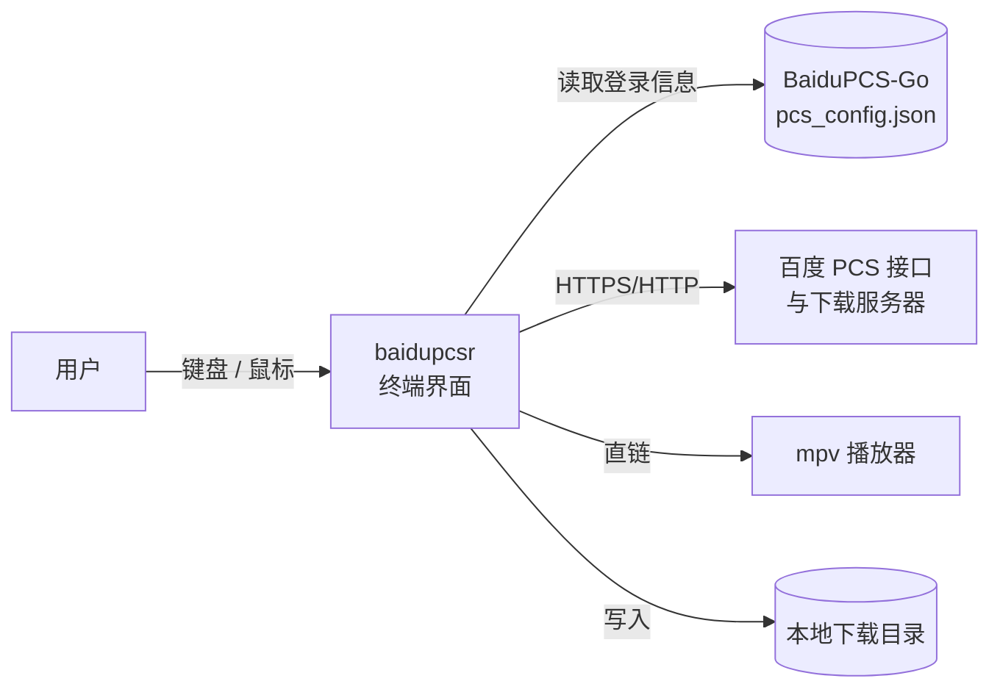
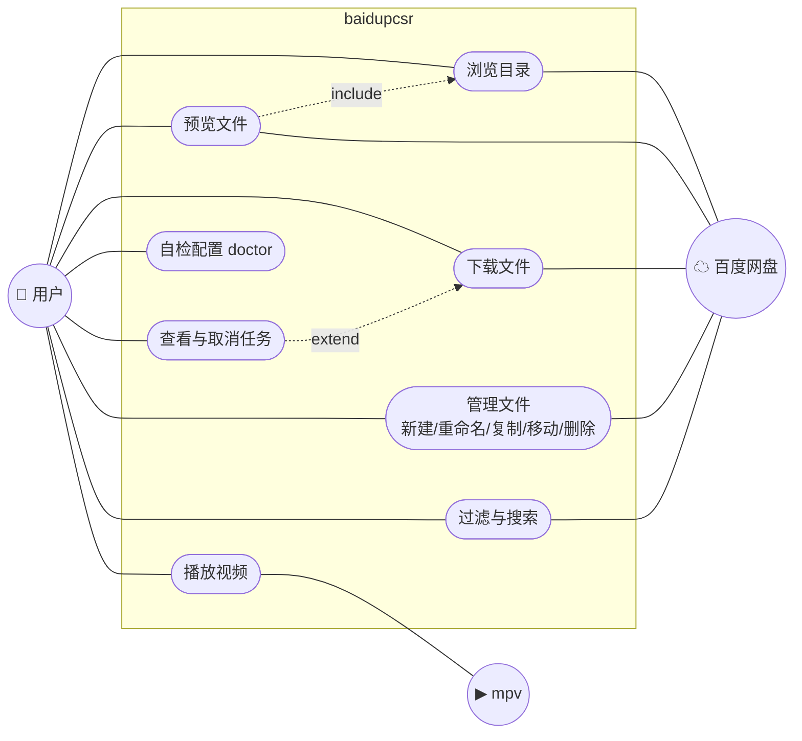

# baidupcsr 需求报告

| 项目 | 内容 |
| --- | --- |
| 项目名称 | baidupcsr —— 百度网盘终端文件管理器 |
| 文档版本 | v1.0 |
| 对应代码版本 | `baidupcsr-cli` 0.1.0（提交 `b328096`） |
| 编写日期 | 2026-10-12 |
| 相关文档 | [项目管理](project-management.md) · [设计说明书](design.md) |

---

## 1 引言

### 1.1 编写目的

本文档描述 baidupcsr 要解决的问题、面向的用户、必须提供的功能和必须满足的质量要求，作为设计、实现、测试和验收的共同依据。功能需求编号（`FR-xx`）和非功能需求编号（`NFR-xx`）会在[设计说明书](design.md)中被引用，用于需求追踪。

### 1.2 项目背景

百度网盘是国内使用最广的网盘之一，但官方 Linux 客户端功能简陋、更新缓慢，也不能在 SSH 远程会话里使用。社区项目 [BaiduPCS-Go](https://github.com/qjfoidnh/BaiduPCS-Go) 提供了命令行访问能力，登录、Cookie 管理做得很成熟，但它是"一条命令做一件事"的交互方式：

- 浏览目录要反复 `cd` / `ls`，看不到文件内容；
- 想确认一个文件是不是自己要的，只能先整个下载下来；
- 看视频要先下载，几个 GB 的文件等待时间很长；
- 批量复制、移动需要手敲完整路径。

另一方面，本地文件管理早已有 ranger、yazi、lf 这类成熟的**终端文件管理器**：三栏（Miller columns）布局、Vim 键位、即时预览。本项目要把这种体验搬到百度网盘上：**直接复用 BaiduPCS-Go 的登录信息，打开就是网盘，浏览、预览、播放、下载、整理都在一个界面里完成。**

### 1.3 术语

| 术语 | 说明 |
| --- | --- |
| PCS | 百度个人云存储（Personal Cloud Storage）REST 接口，`pcs.baidu.com/rest/2.0/pcs/*` |
| BDUSS / STOKEN | 百度登录 Cookie，代表用户身份，属于敏感凭据 |
| locatedownload | 百度获取文件直链（下载地址）的接口，返回多个镜像地址，约 8 小时有效 |
| 直链 / dlink | 可以直接用 HTTP Range 读取文件内容的下载地址 |
| Miller columns | 三栏布局：父目录 │ 当前目录 │ 预览 |
| TUI | 终端用户界面（Text User Interface） |
| `.part` 文件 | 下载中的临时文件，保存已下载的连续前缀，用于断点续传 |
| Nerd Font | 内置大量图标字形的等宽字体 |

### 1.4 参考资料

1. BaiduPCS-Go 源码（仓库内 `reference/` 目录），配置格式与 API 调用方式的事实来源；
2. yazi / ranger 的交互约定（键位、三栏布局、鼠标行为）；
3. Ratatui、Tokio、reqwest 官方文档。

---

## 2 项目概述

### 2.1 产品定位

一句话：**百度网盘的 yazi**。一个跨平台、单文件、无需重新登录的终端网盘文件管理器。



### 2.2 目标用户

| 用户类型 | 特征 | 核心诉求 |
| --- | --- | --- |
| 终端重度用户 | 日常使用 Vim / tmux / yazi，Linux 或 macOS | 键盘操作网盘，不切出终端 |
| 服务器 / NAS 使用者 | 通过 SSH 管理远程机器 | 在无图形界面的机器上把网盘文件拉下来 |
| 影音收藏者 | 网盘里有大量视频 | 不下载、直接在线播放并可拖动进度 |
| BaiduPCS-Go 现有用户 | 已在用命令行版本 | 零迁移成本，沿用现有登录 |

### 2.3 典型使用场景

1. **找文件**：打开程序 → 在三栏里用 `j/k/h/l` 浏览 → 右栏实时看到文本内容或图片缩略图 → 确认后按 `D` 下载。
2. **看视频**：进入影视目录 → 选中视频回车 → mpv 窗口打开并开始播放，可随意拖动进度条。
3. **批量整理**：`Space`/`v` 选中一批文件 → `x` 剪切 → 进入目标目录 → `p` 粘贴。
4. **在服务器上拉文件**：SSH 登录 VPS → 运行程序 → 搜索文件名 → 标记多个文件 → `D` 并发下载，断线后重新运行可续传。

### 2.4 运行环境

| 类别 | 要求 |
| --- | --- |
| 操作系统 | Linux（主要）、macOS、Windows |
| 终端 | 支持 ANSI 颜色的任意终端；图片预览在 kitty / WezTerm / iTerm2 / 支持 sixel 的终端效果最佳，其余终端降级为半块字符 |
| 字体 | 推荐 Nerd Font（显示文件图标）；没有时可切换为 ASCII 图标 |
| 依赖程序 | BaiduPCS-Go（仅用于登录一次）；mpv（可选，用于视频播放）；`xdg-open`/`open`（可选，打开文档） |
| 构建工具 | Rust 1.95+（edition 2024） |

### 2.5 约束与假设

- **C1 不实现登录**：登录涉及验证码、短信、扫码等复杂流程，由 BaiduPCS-Go 负责；本项目只读取其配置。
- **C2 不使用开放平台 API**：百度开放平台需要申请 AppKey 且有限速，本项目沿用 BaiduPCS-Go 使用的 PCS 接口和网盘客户端 UA。
- **C3 直链特性**：百度下载服务器只接受**有界**的 Range 请求（`bytes=N-M`），对开放式 `bytes=N-` 返回 403；直链需要网盘客户端的 User-Agent。
- **C4 单用户本地程序**：不提供服务端、不做多用户共享。
- **A1 假设**用户已经在本机用 BaiduPCS-Go 成功登录过一次。

---

## 3 功能需求

优先级：**P0** 必须实现（缺少则产品不可用）；**P1** 应该实现（核心体验）；**P2** 可以实现（锦上添花）。

### 3.1 功能总览


### 3.2 账号与配置（CFG）

| 编号 | 优先级 | 需求描述 | 验收标准 |
| --- | --- | --- | --- |
| FR-01 | P0 | 自动读取 BaiduPCS-Go 的 `pcs_config.json`，使用其中当前激活账号的 Cookie（BDUSS/STOKEN/BAIDUID 或完整 cookies 串）访问网盘 | 已用 BaiduPCS-Go 登录的机器上，直接运行即可列出网盘根目录，无需任何额外操作 |
| FR-02 | P0 | 配置文件查找顺序：命令行 `--config-dir` > 环境变量 `BAIDUPCS_GO_CONFIG_DIR` > 系统默认位置（Linux/macOS `~/.config/BaiduPCS-Go`，Windows `%APPDATA%\BaiduPCS-Go`） | 三种方式分别指定时都能找到配置 |
| FR-03 | P0 | 兼容不完整或新旧版本的配置文件：缺少的字段使用默认值，不认识的字段忽略 | 只含 `baidu_active_uid` 和一个用户的最小配置能正常加载 |
| FR-04 | P1 | 程序自己的界面偏好放在独立文件 `ui_config.toml`，所有字段可选；支持 `[ui]` 图标集、`[download]` 目录/分片大小/并发数、`[network]` 代理、`[player]` 播放器命令与参数 | 文件不存在时使用默认值；拼写错误的字段或越界的值（如并发数为 0）给出明确错误 |
| FR-05 | P1 | 环境变量覆盖：`BAIDUPCSR_UI_CONFIG`、`BAIDUPCSR_CACHE_DIR`、`BAIDUPCSR_DOWNLOAD_DIR`、`BAIDUPCSR_PROXY`、`NO_COLOR` | 设置后对应行为改变 |
| FR-06 | P1 | `doctor` 子命令：检查缓存目录、界面配置、播放器是否可用、下载参数、配置文件路径及权限、当前账号、BDUSS/STOKEN 是否存在、工作目录；**不输出任何凭据内容** | 输出逐项 ✓/✗；配置异常时退出码非 0；输出中不出现 Cookie 值 |
| FR-07 | P2 | 退出时把当前目录写回 BaiduPCS-Go 配置的 `workdir`（与其 `cd` 命令行为一致），下次启动从该目录开始；写回时保留文件中所有其它字段 | 退出后用 BaiduPCS-Go `pwd` 看到相同目录；配置中未建模的字段不丢失 |
| FR-08 | P2 | `completions <shell>` 子命令输出 bash/zsh/fish 等补全脚本 | 生成的脚本可被 shell 加载 |

### 3.3 目录浏览（NAV）

| 编号 | 优先级 | 需求描述 | 验收标准 |
| --- | --- | --- | --- |
| FR-10 | P0 | Miller columns 三栏布局：左栏父目录、中栏当前目录、右栏预览；终端较窄时自动降为两栏或单栏 | 宽度 ≥100 列三栏；60–99 列两栏；<60 列单栏 |
| FR-11 | P0 | Vim 风格键位：`j/k` 上下、`h` 上级、`l`/回车进入或打开、`gg/G` 首尾、`Ctrl-d/u` 半页、`Ctrl-f/b` 整页；同时支持方向键、Home/End、PageUp/Down | 所有键位在帮助面板中列出且行为一致 |
| FR-12 | P0 | 列表显示文件类型图标、名称、大小；目录排在文件前面；名称过长时，光标停留 1 秒后滚动显示全名 | 中文、emoji 文件名对齐正确 |
| FR-13 | P1 | 顶部面包屑显示当前路径，可点击任一段跳转；路径过长时折叠前段 | 鼠标点击面包屑进入对应目录 |
| FR-14 | P1 | 返回上级目录时，光标停在刚才进入的那个子目录上；每个目录记住上次选中项 | `l` 进入再 `h` 返回，光标位置不变 |
| FR-15 | P1 | 排序：按名称 / 修改时间 / 大小 / 类型，再次选择同一项则反转顺序 | `S` 打开排序菜单，`n/m/s/t` 切换 |
| FR-16 | P1 | 刷新：`R`/`Ctrl-r`/`F5` 强制重新拉取当前目录 | 网盘端变化后刷新可见 |
| FR-17 | P1 | 鼠标：滚轮滚动列表或预览、单击选中、双击或右键打开；点击父目录栏定位到该项、点击预览栏中的子目录直接进入（yazi 行为） | 鼠标操作与键盘结果一致 |
| FR-18 | P1 | 目录列表缓存：本次会话内存缓存 + 跨会话磁盘缓存；再次进入目录时先显示缓存内容，后台刷新后无感更新 | 第二次启动时目录瞬间显示 |
| FR-19 | P1 | 顶栏显示网盘已用 / 总容量 | 登录有效时可见 |
| FR-20 | P1 | `?` 显示分组的帮助面板；状态栏显示模式、位置（第 n/共 m 项）、排序方式、标记数量 | — |

### 3.4 预览（PRV）

| 编号 | 优先级 | 需求描述 | 验收标准 |
| --- | --- | --- | --- |
| FR-30 | P0 | 选中任何条目时，右栏显示元信息：大小（含精确字节数）、修改时间、文件类型；搜索结果额外显示所在目录 | — |
| FR-31 | P0 | 文本 / 代码 / 字幕类文件：只拉取文件**开头 64 KiB** 显示带行号的内容，不下载整个文件、不写磁盘 | 选中 10 GB 的日志文件也能秒开前几页 |
| FR-32 | P1 | 图片：使用百度服务端生成的缩略图（按预览区像素大小请求，最大 1600），在终端中显示；根据终端能力自动选择 kitty / sixel / iTerm2 协议，不支持时降级为半块字符 | 同一张图再次选中时走缓存 |
| FR-33 | P1 | 视频、压缩包、文档等无法直接预览的类型，显示可用操作提示（如"⏎ 在 mpv 中播放 · D 下载"） | — |
| FR-34 | P1 | `Tab` 把焦点切换到预览栏，可滚动查看长文本 | — |
| FR-35 | P0 | 快速移动光标时，旧文件的预览请求必须被取消，界面上永远不会显示"上一个文件"的内容 | 连续按住 `j` 时预览与光标始终对应 |

### 3.5 播放与打开（PLY）

| 编号 | 优先级 | 需求描述 | 验收标准 |
| --- | --- | --- | --- |
| FR-40 | P1 | 视频文件回车：获取直链并交给 mpv 播放，支持拖动进度；只同时保留一个播放器进程 | 几 GB 的视频数秒内开始播放，可任意跳转 |
| FR-41 | P1 | 播放器命令和参数可配置；未安装播放器时给出提示而不是崩溃 | 设置 `[player] command` 后生效 |
| FR-42 | P2 | 非视频文件（≤100 MiB）回车：下载到临时目录后用系统默认程序打开；同一文件再次打开直接复用已下载的副本 | PDF 用系统阅读器打开 |

### 3.6 下载（DL）

| 编号 | 优先级 | 需求描述 | 验收标准 |
| --- | --- | --- | --- |
| FR-50 | P0 | `D` 下载已标记的文件，没有标记时下载光标所在文件；可一次下载多个文件 | — |
| FR-51 | P0 | 单文件分片并发下载：默认 4 MiB 分片、8 个分片同时在途，均可配置 | 带宽充足时吞吐显著高于单连接 |
| FR-52 | P0 | 断点续传：下载过程写入 `<文件名>.part`，中断后再次下载同一文件从断点继续；完成后原子重命名为正式文件名 | 续传后文件与原文件逐字节一致 |
| FR-53 | P0 | 单个分片失败自动重试（退避 0.25 s / 1 s / 4 s）；某个镜像失败时切换到其它镜像；所有镜像都失败时重新获取直链一次 | 网络抖动不导致整个下载失败 |
| FR-54 | P1 | 目标文件已存在时不覆盖，报错提示 | — |
| FR-55 | P1 | 下载目录优先级：`ui_config.toml` / 环境变量 > BaiduPCS-Go 的 `savedir` > 系统下载目录 | — |

### 3.7 文件管理（OPS）

| 编号 | 优先级 | 需求描述 | 验收标准 |
| --- | --- | --- | --- |
| FR-60 | P0 | 选择：`Space` 标记并下移、`v` 区间选择、`V` 全选 / 取消全选、`Esc` 清除 | 状态栏显示已标记数量 |
| FR-61 | P0 | `a` 新建目录、`r` 重命名（输入框预填原名） | — |
| FR-62 | P0 | `y` 复制、`x` 剪切、`p` 粘贴到当前目录；禁止把目录粘贴进自身 | 粘贴到自身子目录时给出错误提示 |
| FR-63 | P0 | `dd` 删除：**必须弹出确认框**，列出将被删除的全部路径 | 未确认前不发出任何删除请求 |
| FR-64 | P1 | `:` 命令行：`mkdir <路径>`、`rename <新名>` / `rename <从> <到>`、`cp/mv [路径…] <目录>`、`rm [路径…]`、`search [--current\|--api] <关键词>`；支持相对路径和引号 | 错误命令显示用法提示 |
| FR-65 | P0 | 操作完成后自动刷新受影响的目录 | 粘贴后目标目录立即出现新文件 |

### 3.8 查找（FND）

| 编号 | 优先级 | 需求描述 | 验收标准 |
| --- | --- | --- | --- |
| FR-70 | P0 | `/` 过滤：在当前目录中按名称实时过滤（不访问网络），回车保留过滤、`Esc` 清除 | 输入每个字符时列表即时变化 |
| FR-71 | P1 | `s` 递归搜索：从当前目录向下逐层列目录、本地匹配名称，结果**边搜边显示**；最多 2000 条 | 搜索过程中可以浏览已出结果 |
| FR-72 | P2 | `:search --api` 使用百度服务端搜索；`--current` 只搜当前目录 | — |
| FR-73 | P1 | 搜索结果视图中可以正常预览、下载、播放；`Esc` 返回原目录 | — |

### 3.9 任务管理（TSK）

| 编号 | 优先级 | 需求描述 | 验收标准 |
| --- | --- | --- | --- |
| FR-80 | P0 | 下载、打开、远程操作、搜索都作为"任务"运行，界面不阻塞 | 下载进行中可以继续浏览 |
| FR-81 | P1 | 屏幕底部的传输栏显示进行中的任务（最多 3 条）：进度条、百分比、速度、剩余时间 | — |
| FR-82 | P1 | `T` 打开任务面板查看全部任务（含历史），可选中某个任务按 `c` 取消 | 取消后 `.part` 保留，下次可续传 |
| FR-83 | P1 | 任务结束时以提示消息（toast）告知结果：成功 / 失败原因 / 已取消 | — |
| FR-84 | P1 | 有进行中的任务时按 `q` 退出需要确认 | — |

### 3.10 用例图



### 3.11 主要用例描述

**UC4 下载文件**

| 项 | 内容 |
| --- | --- |
| 参与者 | 用户、百度网盘 |
| 前置条件 | 已登录；光标位于文件上或已标记若干文件 |
| 基本流程 | 1. 用户按 `D`；2. 系统为每个文件创建下载任务，传输栏出现进度；3. 系统获取直链，按分片并发拉取并顺序写入 `.part`；4. 全部完成后重命名为正式文件，提示"已保存到 …" |
| 备选流程 | 3a. 分片失败：重试 3 次，换镜像，必要时重新获取直链；3b. 用户在任务面板按 `c`：停止请求，保留 `.part`，提示"已取消" |
| 异常流程 | 目标文件已存在 → 任务失败并提示；磁盘写入失败 → 任务失败并显示系统错误 |
| 后置条件 | 下载目录中出现完整文件，或保留可续传的 `.part` |

**UC3 播放视频**

| 项 | 内容 |
| --- | --- |
| 参与者 | 用户、百度网盘、mpv |
| 前置条件 | 已安装 mpv（或配置了其它播放器）；光标位于视频文件 |
| 基本流程 | 1. 用户按回车；2. 系统提示"正在打开…"；3. 系统获取直链并用 1 字节 Range 请求找到第一个可用镜像；4. 启动播放器，传入直链、网盘 UA、有界 Range 请求参数和标题 |
| 异常流程 | 播放器不存在 → 提示安装或配置；所有镜像不可用 → 提示"无法播放"及原因 |
| 后置条件 | 播放器窗口打开；再次播放其它视频时关闭前一个 |

**UC5 删除文件**

| 项 | 内容 |
| --- | --- |
| 前置条件 | 光标位于条目上或已标记若干条目 |
| 基本流程 | 1. 用户连按 `dd`；2. 弹出确认框列出所有待删除路径；3. 用户按 `y`/回车；4. 系统调用删除接口，成功后刷新目录并提示 |
| 备选流程 | 2a. 用户按 `n`/`Esc` → 关闭对话框，不做任何事 |

---

## 4 非功能需求

### 4.1 性能

| 编号 | 需求 | 指标 |
| --- | --- | --- |
| NFR-01 | 界面永不因网络阻塞 | 所有网络与磁盘 I/O 在后台任务中执行；任何网络状态下按键响应 < 100 ms |
| NFR-02 | 空闲零占用 | 没有动画和任务时不重绘、不轮询，CPU 占用为 0 |
| NFR-03 | 下载吞吐 | 千兆网络、默认参数下单文件可达约 65 MiB/s（受百度限速影响） |
| NFR-04 | 内存有界 | 文本预览缓存 ≤16 MiB、缩略图缓存 ≤32 MiB；单张缩略图 ≤8 MiB；图片解码内存 ≤128 MiB；任务历史最多保留 64 条 |
| NFR-05 | 大目录 | 上万条目的目录滚动、过滤流畅 |

### 4.2 可靠性

| 编号 | 需求 |
| --- | --- |
| NFR-10 | 所有后台操作可取消；退出时等待后台任务最多 2 秒，然后强制结束 |
| NFR-11 | 过期结果不覆盖新结果：同一目录被多次刷新时，只采纳最后一次请求的结果 |
| NFR-12 | 下载数据完整性：校验每个分片的响应码必须为 206、`Content-Range` 必须与请求一致、长度必须相等，否则视为失败 |
| NFR-13 | 配置与缓存写入使用"写临时文件 + 原子重命名"，断电不会留下半截文件 |
| NFR-14 | 网络异常、登录过期、文件不存在等错误给出可读的提示（附百度错误码含义），程序不崩溃 |

### 4.3 安全

| 编号 | 需求 |
| --- | --- |
| NFR-20 | 凭据只在 HTTP 客户端内部使用，不出现在日志、界面、`doctor` 输出中 |
| NFR-21 | 对 BaiduPCS-Go 配置文件只读，唯一例外是写回 `workdir` 字段，且保留其它所有字段 |
| NFR-22 | 删除这类不可逆操作必须二次确认 |
| NFR-23 | 不请求百度的 P2P"加速"镜像（`*-ant.*`），这些节点会返回被打乱的数据 |
| NFR-24 | 代码层面禁止 `unsafe`，禁止 `unwrap`/`expect`/`panic`（由编译器 lint 强制） |
| NFR-25 | `doctor` 检查配置文件权限，提示"对其他用户可读"的风险 |

### 4.4 可用性与兼容性

| 编号 | 需求 |
| --- | --- |
| NFR-30 | 熟悉 Vim / yazi / ranger 的用户无需学习即可上手；`?` 随时查看全部键位 |
| NFR-31 | 只使用终端 16 色调色板，跟随用户终端主题（深色/浅色都可读）；支持 `NO_COLOR` |
| NFR-32 | 支持无 Nerd Font 的环境（`icons = "ascii"`） |
| NFR-33 | 正确处理中日韩宽字符与 emoji 的显示宽度 |
| NFR-34 | Linux、macOS、Windows 均可编译运行；发布为单个可执行文件，无运行时依赖 |
| NFR-35 | 支持通过 HTTP/SOCKS5 代理访问网盘 |

### 4.5 可维护性

| 编号 | 需求 |
| --- | --- |
| NFR-40 | 界面状态与副作用分离：界面逻辑可在不联网、不开终端的情况下单元测试 |
| NFR-41 | 界面渲染有快照测试，布局改动可被审查 |
| NFR-42 | 优先使用成熟库处理协议解析（Cookie、HTTP 头、TOML、命令行分词等），不手写 |

---

## 5 数据需求

| 数据 | 来源 | 存储位置 | 说明 |
| --- | --- | --- | --- |
| 账号与凭据 | BaiduPCS-Go | `~/.config/BaiduPCS-Go/pcs_config.json` | 只读（`workdir` 除外） |
| 界面配置 | 用户 | `~/.config/baidupcsr/ui_config.toml` | 可选 |
| 目录缓存 | 网盘列表接口 | `~/.cache/baidupcsr/dir-<uid>-<hash>.json` | 按账号隔离，可随时删除 |
| 预览缓存 | 下载接口 / 缩略图接口 | 内存 | LRU，进程退出即释放 |
| 下载文件 | 下载服务器 | 下载目录 | `.part` 用于续传 |
| 打开文件的临时副本 | 下载服务器 | 系统临时目录 `baidupcsr-open/<uid>/` | 以 `fs_id-mtime-文件名` 命名，可复用 |

文件条目的核心字段：`fs_id`（文件 ID）、`path`（完整路径）、`server_filename`（文件名）、`size`、`mtime`、`isdir`。

---

## 6 外部接口需求

### 6.1 用户界面

终端全屏界面，从上到下：标题栏（面包屑 + 容量）→ 主体三栏 → 传输栏（有任务时出现）→ 状态栏（模式徽标、位置、排序、提示）。弹出层：帮助、排序菜单、任务面板、确认框、输入行。界面效果见 [README](../README.md) 中的动图。

### 6.2 命令行接口

```text
baidupcsr-cli                     # 打开文件管理器（默认）
baidupcsr-cli tui                 # 同上
baidupcsr-cli doctor [--config-dir <DIR>]
baidupcsr-cli completions <SHELL>
baidupcsr-cli --version | --help
```

### 6.3 网络接口

| 接口 | 方法 | 用途 |
| --- | --- | --- |
| `/rest/2.0/pcs/file?method=list` | GET | 列目录 |
| `/rest/2.0/pcs/file?method=search` | GET | 服务端搜索 |
| `/rest/2.0/pcs/file?method=locatedownload` | POST | 获取直链（需签名） |
| `/rest/2.0/pcs/file?method=mkdir` | POST | 新建目录 |
| `/rest/2.0/pcs/file?method=delete\|copy\|move` | POST（multipart `param`） | 批量删除 / 复制 / 移动与重命名 |
| `/rest/2.0/pcs/thumbnail?method=generate` | GET | 图片缩略图 |
| `https://pan.baidu.com/api/quota` | GET | 容量 |
| 下载服务器直链 | GET + `Range: bytes=N-M` | 读取文件内容 |

### 6.4 软件接口

- **mpv**：通过命令行参数传入直链、`--user-agent`、`--stream-lavf-o` 有界请求大小、`--force-media-title`；
- **系统打开程序**：Linux `xdg-open`/`gio open`，macOS `open`，Windows `start`。

---

## 7 验收标准汇总

1. 所有 P0 需求通过功能测试；P1 需求实现率 ≥ 90%；
2. `cargo test` 全部通过，`cargo clippy` 无告警；
3. 在真实账号上完成冒烟测试：浏览、文本/图片预览、播放 4K 视频并拖动、下载并中断续传（逐字节校验）、新建/重命名/复制/移动/删除、递归搜索；
4. `doctor` 输出中不含任何凭据；
5. 在 80×24 终端和 200 列以上宽屏终端中布局都正确。

## 8 需求变更记录

| 日期 | 变更 | 原因 |
| --- | --- | --- |
| 2026-05-17 | 初版：视频播放必须经过本地回环代理，播放器不得直连百度 | 希望由程序控制缓存与流量 |
| 2026-10-02 | 改为直接把直链交给 mpv，并让 mpv 发出有界 Range 请求 | 代理约 1300 行代码、带来额外进程与延迟；实测 mpv 直连同样可拖动且更稳定（见[设计说明书 §9](design.md#9-设计决策记录)） |
| 2026-10-07 | 图片预览从"下载文件开头解码"改为使用服务端缩略图 | 大图只下载开头无法解码；缩略图体积小、清晰度可控 |
